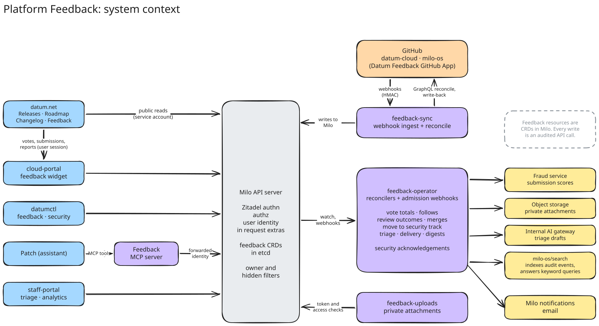
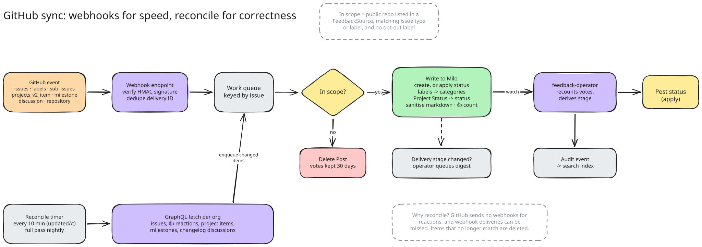
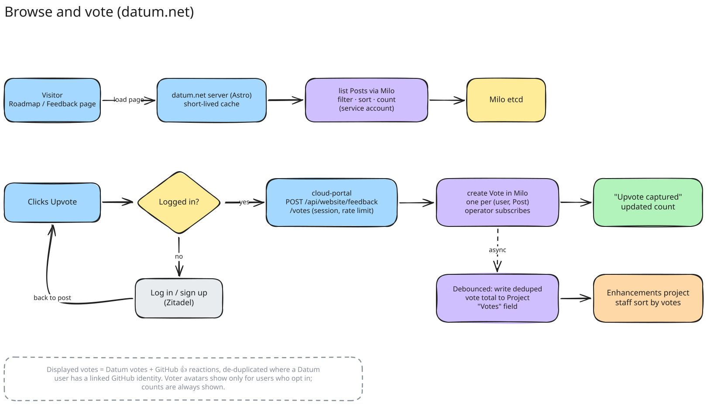
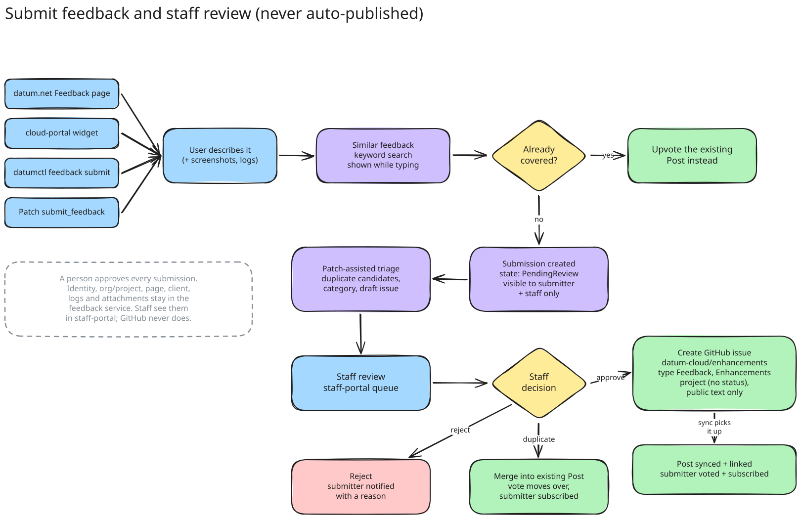
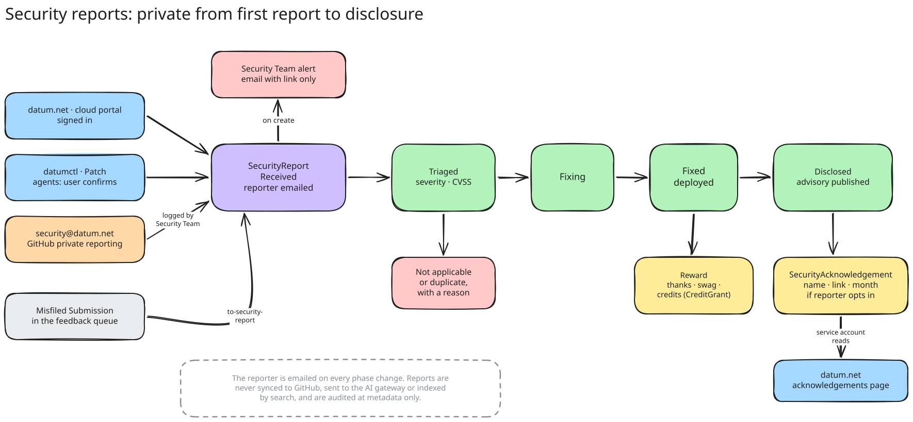
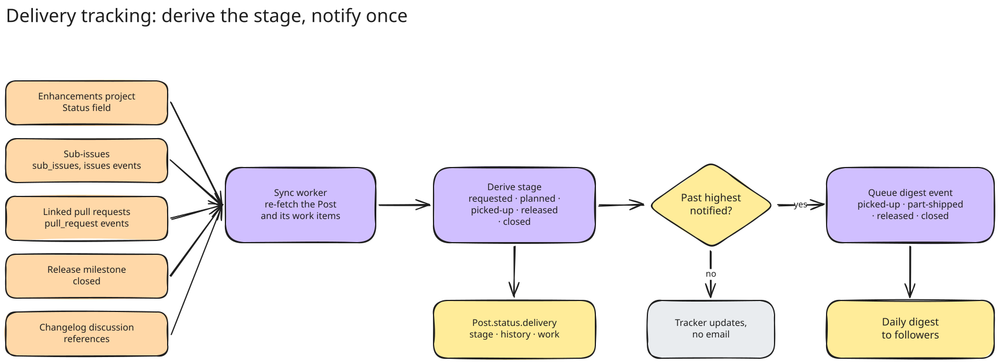

<!-- omit from toc -->
# Platform Feedback: Architecture

- [Summary](#summary)
- [Constraints](#constraints)
- [Architecture](#architecture)
- [API Resources](#api-resources)
  - [FeedbackSource](#feedbacksource)
  - [Post](#post)
  - [Listing and searching posts](#listing-and-searching-posts)
  - [Vote](#vote)
  - [Submission](#submission)
  - [SubmissionReview](#submissionreview)
  - [SecurityReport](#securityreport)
  - [SecurityReportTriage](#securityreporttriage)
  - [Subscription](#subscription)
  - [Release](#release)
  - [ChangelogEntry](#changelogentry)
- [GitHub Sync](#github-sync)
- [Status and Category Mapping](#status-and-category-mapping)
- [Votes](#votes)
- [Submissions and Staff Review](#submissions-and-staff-review)
- [Security Reports](#security-reports)
- [Delivery Tracking](#delivery-tracking)
- [Notifications](#notifications)
- [Clients](#clients)
- [Staff Analytics](#staff-analytics)
- [Security and Privacy](#security-and-privacy)
- [Rollout](#rollout)
- [Production Readiness](#production-readiness)
- [Alternatives](#alternatives)
- [Infrastructure Needed](#infrastructure-needed)
- [Implementation History](#implementation-history)

## Summary

This is the technical design for [Platform Feedback][product], which covers
the product behaviour. It describes how the service is built: CRDs in
Milo (`feedback.miloapis.com`) and an operator, like billing and
service-catalog. It syncs public roadmap issues, milestones and changelog
discussions from GitHub, stores votes and submissions tied to Milo users,
and serves the website, cloud portal, datumctl, Patch and staff portal
through Milo's API.

Tracking issue: [datum-cloud/enhancements#889][issue].

[product]: ../../../enhancements/platform/feedback/README.md
[issue]: https://github.com/datum-cloud/enhancements/issues/889

## Constraints

These shape most of the design:

- **GitHub stays the source of truth** for public item content and status.
  The service only writes to GitHub when staff approve a submission and
  when it mirrors vote totals.
- **GitHub sends no webhooks for reactions.** 👍 counts can only be polled,
  so they lag other fields by up to one sweep interval.
- **Webhook delivery is best effort.** Periodic reconciliation is required
  for correctness, not just as a fallback.
- **Only public repositories are synced.** A repository going private
  removes its items on the next reconcile.
- **Submissions are never auto-published.** Only a staff decision can create
  a GitHub issue.
- **Private context never leaves the service.** Submitter identity,
  organization, project, logs and attachments are never written to GitHub.
- **Anonymous website visitors never call Milo.** The datum.net server reads
  on their behalf with a service account.

## Architecture



*System context. The editable sources for every diagram in this document
are the `.excalidraw` files in [`diagrams/`](./diagrams).*

The service follows the billing and service-catalog pattern: CRDs
installed in Milo, an operator that reconciles them, and admission
webhooks for the rules CRD validation can't express. Every resource is
stored in Milo's etcd.

| Component | Responsibility |
| --- | --- |
| **feedback-operator** | Reconciles feedback resources in Milo: vote totals and trending scores, follows created by votes, review outcomes, merges, submissions moved to the security track, security acknowledgements, delivery tracking events and digest emails. Serves the admission webhooks Milo calls for feedback resources. |
| **feedback-webhook** | Public HTTPS endpoint for GitHub App webhooks. Verifies `X-Hub-Signature-256`, drops events for private repos, publishes to NATS JetStream. No other processing. |
| **feedback-sync** | Consumes webhook events and runs periodic GraphQL reconciliation. Creates and updates posts, releases and changelog entries in Milo. The only component with GitHub write access: creates approved issues and mirrors vote totals. |
| **feedback-uploads** | Public HTTPS endpoint for submission and security report attachments. Authenticates callers against Milo, stores files in private object storage, and serves them back only to their owner and staff. |
| **feedback-mcp** | MCP server exposing feedback tools to Patch. |

Backing services:

- **Milo** for every feedback resource, audit, authorization and watch.
- **Search service** ([`milo-os/search`][search]) for keyword search over
  posts, releases and changelog entries, indexed from the audit log like
  any other platform resource. It also finds similar posts while people
  write feedback.
- **NATS JetStream** to buffer webhook events.
- **Internal AI gateway** for triage drafts.
- **Object storage** for private attachments.
- **Milo `Email` resources** for digest emails.

**Identity.** Milo authenticates every request and passes the caller's
context in user extras (`iam.miloapis.com/parent-type`, `parent-name`).
User-owned resources carry the owner in `spec.userRef.name`, set by the
admission webhook from the request and immutable after that.

**Writes go through Milo.** Every write, including those from
`feedback-sync`, `feedback-operator` and `feedback-uploads`, is a request
to Milo. That puts every change in the audit log, lets the search service
index feedback resources, and keeps authorization in one place.

**Audit.** Milo audits feedback resources like any other CRD. A Milo audit
policy rule logs `Submission`, `SubmissionReview`, `SecurityReport` and
`SecurityReportTriage` at `Metadata` only, so private context and
vulnerability details never reach the audit log, activity or search.
Everything else is logged at `RequestResponse`, which the search indexer
needs.

**User-owned resources.** Milo stores resources a user owns in one
collection for the whole platform; only projects get their own storage.
Authorization can say whether a user may list votes in their own context,
but not which votes come back. Milo already handles this for contacts and
invitations with one hard-coded request filter per resource. Feedback adds
a generic version to Milo, driven by annotations on the CRD:

- `iam.miloapis.com/owner-field: spec.userRef.name`. In the user context
  (and in an organization context, where the owner is the caller), Milo adds
  `spec.userRef.name=<user>` to every list, watch and collection delete,
  replacing any value the client sent, and answers `get`, `update`, `patch`
  and `delete` on another user's object with `NotFound`. An admission plugin
  in Milo refuses a create whose owner isn't that user, and any change of
  owner, after the feedback webhook has filled the owner in.
- `iam.miloapis.com/hidden-field: spec.hidden` and
  `iam.miloapis.com/hidden-subresource: hidden`. Milo adds
  `spec.hidden!=true` to every list, watch and collection delete, and
  answers named requests for a hidden object with `NotFound`, unless the
  caller is allowed `get` on the `hidden` subresource.

Both fields are CRD `selectableFields`, so etcd filters on them like
`metadata.name`. The filter keeps the operator of every other term the
client sent. Later services can use the same annotations instead of adding
filters to Milo.

**API contexts.**

| Resource | Platform context (staff) | Platform context (service accounts) | User context |
| --- | --- | --- | --- |
| `FeedbackSource` | read/write | `feedback-sync`: read | none |
| `Post` | read, hide/unhide | `feedback-sync`: create, update, delete, apply `status`; `feedback-operator`: apply `status` | read, hidden posts filtered |
| `Release`, `ChangelogEntry` | read | `feedback-sync`: create, update, delete, apply `status` | read |
| `Vote`, `Subscription` | list all | `feedback-operator`: create, delete | create, read, delete own |
| `Submission` | list all | `feedback-operator`: update `status`; `feedback-uploads`: read | create, read own |
| `SubmissionReview` | read/write | `feedback-operator`: read, update `status` | none |
| `SecurityReport` | Security Team only: list all, update `status` | `feedback-operator`: create, update `status`; `feedback-uploads`: read | create, read own |
| `SecurityReportTriage` | Security Team only | none | none |
| `SecurityAcknowledgement` | read | `feedback-operator`: create, update, delete | read |
| `FeedbackProfile` | read | `feedback-operator`: read | create, read, update own |
| `FeedbackDigest` | read | `feedback-operator`: read/write | none |

`Post`, `Release` and `ChangelogEntry` are readable by any authenticated
principal, including the datum.net service account. Their GitHub-derived
fields live in `status` and can only be written by `feedback-sync`; staff
can only patch `spec.hidden`. `feedback-sync` and `feedback-operator` both
write `Post` status with server-side apply under their own field managers:
sync owns the GitHub fields, the operator owns `votes` and `delivery`.

**Side effects are reconciled.** A request writes one object, and the
operator makes everything that follows from it true shortly after:

- A new `Vote` gets the voter a `Subscription`, and the post's
  `votes.total` and `trendingScore` are recomputed.
- An approve or merge decision on a `SubmissionReview` gets the submitter
  a `Vote` and a `Subscription`.
- A post merged into another has its votes moved to the target.

Every step is idempotent and keyed on deterministic names, so a crash or
retry never duplicates a vote or a follow. Vote totals lag the vote by
the operator's reconcile time, normally under a second. The operator's own
writes are audited under its service account.

[search]: https://github.com/milo-os/search

## API Resources

> [!NOTE]
> Field names and shapes are illustrative and will change during
> implementation.

### FeedbackSource

One per GitHub org. Defines what to sync and how to map it.

```yaml
apiVersion: feedback.miloapis.com/v1alpha1
kind: FeedbackSource
metadata:
  name: datum-cloud
spec:
  github:
    org: datum-cloud
    installationID: 12345678
    repositories:              # private repos are always skipped
      include: ["*"]
      exclude: ["infra", "staff-portal"]
    issues:                    # any match includes
      issueTypes: ["Enhancement", "Feedback", "Bug"]
      labels: ["Build", "Deliver", "Connect", "Platform Features"]
      excludeLabels: ["feedback:hide"]
    project:                   # the Enhancements project
      owner: datum-cloud
      number: 22
      statusField: Status
      votesField: Votes        # number field the service writes to
    milestones:
      repository: enhancements # source for Release resources
    changelog:
      repository: datum
      discussionCategory: changelog
  statusMapping:
    "": none
    "Backlog": backlog
    "Planning": planning
    "On Deck": on-deck
    "In progress": in-progress
    "Done": shipped
  categoryMapping:
    "Build": build
    "Deliver": deliver
    "Connect": connect
    "Platform Features": platform
    "Infrastructure": infrastructure
    "AX/DX/UX": experience     # used on changelog discussions
status:
  conditions:
    - type: Ready
      status: "True"
  lastWebhookAt: "2026-10-08T12:03:11Z"
  lastReconcile:
    completedAt: "2026-10-08T12:00:00Z"
    postsSynced: 412
  rateLimit:
    remaining: 4710
    resetAt: "2026-10-08T13:00:00Z"
```

The `milo-os` source has its own repositories but points `project` at the
same Enhancements project (`owner: datum-cloud`, `number: 22`), so both
orgs share one set of statuses and one Votes field. It has no `milestones`
or `changelog` block.

### Post

A public item synced from a GitHub issue. Every `Post` is backed by a GitHub
issue; unreviewed feedback is a `Submission`, never a `Post`. Only
`feedback-sync` creates, updates and deletes posts; for everyone else they
are read-only except for staff hiding.

```yaml
apiVersion: feedback.miloapis.com/v1alpha1
kind: Post
metadata:
  name: datum-cloud.enhancements.912
  labels:                    # for label selectors; set by sync and the operator
    feedback.miloapis.com/org: datum-cloud
    feedback.miloapis.com/status: in-progress
    feedback.miloapis.com/stage: picked-up
    category.feedback.miloapis.com/build: ""
spec:
  hidden: false              # staff-only toggle, a selectable field
status:
  title: Bare Metal Infrastructure service
  summary: Expands Datum's platform to support full lifecycle management ...
  bodyHTML: "<h3>High-Level Summary</h3><p>This enhancement ...</p>"
  status: in-progress
  categories: [build]
  labels: [Build]
  issueType: Enhancement
  github:
    org: datum-cloud
    repository: enhancements
    number: 912
    url: https://github.com/datum-cloud/enhancements/issues/912
    state: open
    createdAt: "2026-09-30T14:12:00Z"
    updatedAt: "2026-10-07T09:40:00Z"
  release: hedy-2-0          # set when the issue is on a milestone
  votes:
    total: 9                 # datum + github, deduped where linked
    datum: 6
    github: 4
    trendingScore: 3.42
  publicVoters:              # only users who opted in, max 10
    - displayName: Ada L.
      avatarURL: https://...
  delivery:                  # see Delivery Tracking
    stage: picked-up
    highestNotified: picked-up
    history:
      - {stage: requested, at: "2026-09-30T14:12:00Z"}
      - {stage: planned, at: "2026-10-02T09:00:00Z"}
      - stage: picked-up
        at: "2026-10-07T09:40:00Z"
        cause: datum-cloud/compute#318 opened, closes datum-cloud/compute#311
    work:
      total: 5                 # sub-issues, or linked PRs if none
      done: 3
      items:
        - kind: issue
          ref: datum-cloud/compute#311
          title: BMC inventory API
          state: open
          url: https://github.com/datum-cloud/compute/issues/311
          pullRequests:
            - {ref: datum-cloud/compute#318, state: open}
      partShipped:
        - {changelog: datum-cloud.datum.303, at: "2026-10-07T13:23:39Z"}
  lastSyncedAt: "2026-10-08T12:00:00Z"
```

### Listing and searching posts

There is no query resource. Clients list `Post`s from Milo and search
through the search service.

- **Filters** are label selectors: `feedback.miloapis.com/status`,
  `feedback.miloapis.com/org`, `feedback.miloapis.com/stage` and one
  `category.feedback.miloapis.com/<category>` label per category. Milo
  removes hidden posts from every list (see
  [Architecture](#architecture)).
- **Sorts and counts** are done by the client. There are about 1,700 open
  issues across both orgs, not all of which become posts, so the
  datum.net and cloud portal servers keep the full list in a 60-second
  cache and sort and count it in memory. datumctl lists with label
  selectors and sorts locally.
  - `top`: `votes.total` descending.
  - `newest`: GitHub `createdAt` descending.
  - `trending`: `votes.trendingScore` descending. The score weights votes
    with a 7-day half-life, `Σ 0.5^(age_days / 7)`, over Datum votes and
    GitHub reactions. The operator updates it when votes change and
    refreshes it hourly.
  - `recentlyChanged`: latest `delivery.history` entry first. Used by My
    feedback.
- **Voted and followed** state comes from listing the caller's own `Vote`s
  and `Subscription`s in the user context, which Milo limits to the
  caller.
- **Keyword search** is a `ResourceSearchQuery` against the posts index,
  made with the caller's own credentials, ranked by the search service.
- **Similar posts** while someone writes feedback are the same query with
  the draft title and the start of the body as the text. It is keyword
  matching, not semantic similarity. It drives the "similar feedback" list
  and the duplicate checks in datumctl and Patch.

**Search index.** A `ResourceIndexPolicy` per kind indexes `Post`,
`Release` and `ChangelogEntry`: title, summary or body text, categories,
labels and status. Derived fields (`votes`, `trendingScore`, `delivery`)
are not indexed, since they change as side effects and would go stale in
the index. Hidden posts are excluded by the policy's CEL condition. This
also makes feedback findable through platform search.

<<[UNRESOLVED post list size]>>
A full post list with `bodyHTML` is several megabytes. That is fine for
the datum.net and portal servers' caches, but too much for a browser or a
default `datumctl` call, and Kubernetes lists can't leave fields out.
Either move `bodyHTML` to a separate `PostBody` kind fetched one post at a
time, or accept the size because only servers list every post.
<<[/UNRESOLVED]>>

### Vote

Created in the user context. Every user's votes share one collection, so
the name is the post name and the voter's user ID, which makes it one vote
per user per post. The admission webhook checks the name and sets
`spec.userRef` from the request. Deleting the vote removes it.

```yaml
apiVersion: feedback.miloapis.com/v1alpha1
kind: Vote
metadata:
  name: datum-cloud.enhancements.912.312983457298312345
spec:
  postRef:
    name: datum-cloud.enhancements.912
  userRef:
    name: "312983457298312345"   # set by the webhook, selectable field
  source: website            # website | portal | datumctl | patch
status:
  organizations: [acme-corp] # recorded for staff analytics, never public
  githubLogin: ada           # linked GitHub username, for dedupe
```

The operator follows the post for the voter and recomputes the post's
totals.

### Submission

Created and read in the user context by the submitter. Staff read all
submissions in the platform context. It holds only what the submitter may
see; triage and the staff decision live on its `SubmissionReview`.

```yaml
apiVersion: feedback.miloapis.com/v1alpha1
kind: Submission
metadata:
  name: sub-7f3k2
spec:
  userRef:
    name: "312983457298312345"
  kind: idea                  # idea | bug | other
  title: Let me pick the region for Galactic VPC attachments
  body: |
    When I attach a VPC I can't choose which region ...
  attachments:
    - name: screenshot.png
      contentType: image/png
      uploadRef: att-91ac      # returned by feedback-uploads
  context:                     # private, never sent to GitHub
    client: portal             # website | portal | datumctl | patch
    pageURL: https://cloud.datum.net/org/acme/projects/web/vpc
    organization: acme-corp
    project: web
    requestIDs: [req-01HZX...]
    clientVersion: cloud-portal@2026.10.1
status:                        # written by the operator
  phase: PendingReview        # PendingReview | Approved | Merged | Rejected
  reason: ""                  # shown to the submitter when Rejected
  postRef:
    name: datum-cloud.enhancements.931
```

### SubmissionReview

Staff only. One per submission, with the same name, created by the
operator when the submission arrives. Staff write the decision in `spec`;
the operator writes triage to `status` and applies the decision to the
`Submission`.

```yaml
apiVersion: feedback.miloapis.com/v1alpha1
kind: SubmissionReview
metadata:
  name: sub-7f3k2
spec:
  decision: Approved          # "" | Approved | Merged | Rejected | MoveToSecurity
  publicTitle: Region selection for Galactic VPC attachments
  publicBody: "..."           # staff-edited, what goes to GitHub
  mergedInto: ""              # post name when decision is Merged
  reason: ""                  # shown to the submitter when Rejected
  affected: ""                # for MoveToSecurity
status:
  reviewer: staff:jdoe@datum.net   # set by the webhook from the request
  reviewedAt: "2026-10-09T10:00:00Z"
  triage:                     # advisory, written by the operator
    suggestedCategories: [connect]
    suggestedKind: idea
    similarPosts:
      - name: datum-cloud.enhancements.840
    draftIssue:
      title: Region selection for Galactic VPC attachments
      body: "### Summary\n..."
    fraudScore: 0.02
```

A decision can't change once it's set.

### SecurityReport

A private vulnerability report. It is a separate resource from
`Submission` so it can have its own role: only the Security Team can list
or triage reports, and general feedback reviewers can't see them.
Reporters create and read their own in the user context.

```yaml
apiVersion: feedback.miloapis.com/v1alpha1
kind: SecurityReport
metadata:
  name: sec-4m8q1
spec:
  userRef:                      # empty for reports logged for external reporters
    name: "312983457298312345"
  title: Project viewer can read connector credentials
  description: |
    A user with the viewer role on a project can ...
  affected: connectors          # free text, helps routing
  stepsToReproduce: |
    1. ...
  impact: Credential disclosure across users in one project
  attachments:
    - name: poc.sh
      contentType: text/x-shellscript
      uploadRef: att-c71e
  credit:                       # how the reporter wants to be credited
    public: true
    name: Ada L.
    url: https://example.com
  reporter:                     # set only for reports logged by the Security Team
    email: ""
    githubLogin: ""
  context:
    client: patch               # website | portal | datumctl | patch | email | github
    filedByAgent: true
    organization: acme-corp
    clientVersion: patch@2026.10.2
status:                         # Security Team; the reporter can read it
  phase: Triaged                # Received | Triaged | Fixing | Fixed | Disclosed | NotApplicable | Duplicate
  severity: high                # critical | high | medium | low | informational
  cvssVector: "CVSS:3.1/AV:N/AC:L/PR:L/UI:N/S:U/C:H/I:N/A:N"
  reason: ""                    # shown to the reporter for NotApplicable and Duplicate
  timeline:
    - {phase: Received, at: "2026-10-27T09:12:00Z"}
    - {phase: Triaged, at: "2026-10-27T15:40:00Z", note: Confirmed, fix in progress soon}
  advisory:
    url: https://github.com/datum-cloud/datum/security/advisories/GHSA-xxxx
    cve: ""
  reward:
    kind: credits               # none | thanks | swag | credits
    amount: "250.00"
    creditGrantRef: {name: security-sec-4m8q1}   # billing CreditGrant
    grantedAt: "2026-11-04T10:00:00Z"
```

### SecurityReportTriage

Security Team only, with the same name as its report. It holds what the
reporter must not see, which a field on the report can't hide.

```yaml
apiVersion: feedback.miloapis.com/v1alpha1
kind: SecurityReportTriage
metadata:
  name: sec-4m8q1
spec:
  assignee: staff:jdoe@datum.net
  duplicateOf: ""
  tracking: ""                  # private issue or draft advisory
  notes: "..."
```

### Subscription

Links a user to a post they follow. The operator creates one when a user
votes or when their submission is approved or merged; users can create and
delete their own. Named like a `Vote`.

```yaml
apiVersion: feedback.miloapis.com/v1alpha1
kind: Subscription
metadata:
  name: datum-cloud.enhancements.912.312983457298312345
spec:
  postRef:
    name: datum-cloud.enhancements.912
  userRef:
    name: "312983457298312345"
  reason: voted               # voted | submitted | merged | manual
```

### Release

Maps to a milestone in `datum-cloud/enhancements`, which is what datum.net's
`githubRoadmap.ts` reads today.

```yaml
apiVersion: feedback.miloapis.com/v1alpha1
kind: Release
metadata:
  name: hedy-2-0
status:
  title: "Hedy: 2.0"
  codename: Hedy
  version: "2.0"
  dueOn: "2026-10-31"
  shipped: false              # milestone closed
  descriptionHTML: "<p>...</p>"
  coverImage: hedy-2-0        # key into website assets
  posts:
    - datum-cloud.enhancements.912
    - datum-cloud.enhancements.913
  github:
    url: https://github.com/datum-cloud/enhancements/milestone/14
    number: 14
```

Cover images stay as static website assets keyed by release name.

### ChangelogEntry

Maps to a discussion in the `changelog` category of `datum-cloud/datum`,
which is where changelog posts are written today and what datum.net's
`changelogs()` in `src/libs/datum.ts` reads.

```yaml
apiVersion: feedback.miloapis.com/v1alpha1
kind: ChangelogEntry
metadata:
  name: datum-cloud.datum.303
status:
  title: "Application Load Balancer: wildcard hostnames"
  publishedAt: "2026-10-07T13:23:39Z"
  categories: [deliver]       # from discussion labels via categoryMapping
  bodyHTML: "<p>...</p>"      # sanitised, like Post bodies
  posts:                      # issues referenced in the body
    - datum-cloud.enhancements.913
  reactions: {thumbsUp: 4}
  github:
    url: https://github.com/datum-cloud/datum/discussions/303
    number: 303
```

- Bodies are free-form markdown; Changed/New/Fixed groups are headings in
  the post, not parsed fields.
- Linked posts come from issue references in the body (`#913`,
  `datum-cloud/enhancements#913`, or full issue URLs). A new link queues a
  "shipped" update for that post's followers.
- Moving a discussion out of the `changelog` category hides the entry.

## GitHub Sync



*Webhook and reconcile paths share the same write path to Milo.*

**GitHub App.** One app, "Datum Feedback", installed on `datum-cloud` and
`milo-os`. Permissions:

- Issues: read/write (write to create approved issues)
- Metadata: read
- Organization projects: read/write on `datum-cloud` (write for the Votes
  field)
- Discussions: read (changelog)
- Pull requests: read (linked pull requests for delivery tracking)

It replaces the app datum.net uses today once datum.net is migrated.

**Webhooks.** `issues`, `label`, `issue_comment` (comment counts only),
`sub_issues`, `projects_v2_item`, `milestone`, `discussion`, and `repository`
(visibility changes). Events are published to a JetStream subject keyed by
`org/repo/number` so events for one item are processed in order. Project
item events arrive through the `datum-cloud` installation for issues in
either org.

**Upsert.** The sync worker re-fetches the item through GraphQL rather than
trusting the webhook payload. That keeps one code path for webhooks and
reconciliation and picks up fields payloads lack (project Status, issue
type, `bodyHTML`). It then applies the source's include/exclude rules, maps
status and categories, sanitises HTML, and writes the result through the
Milo: `create` for a new item, otherwise a server-side apply of its
labels and `status` under the `feedback-sync` field manager, skipped when
nothing changed. If an item no longer matches (label removed, repo
private, issue deleted) the sync worker deletes the `Post`. Its votes are
kept for 30 days in case it returns; the operator deletes them after
that.

**Reconciliation.**

- Every 10 minutes per source: GraphQL search `updated:>{last}` across
  included repos.
- Every 30 minutes: 👍 sweep over tracked open posts, 100 issues per query
  (`reactions(content: THUMBS_UP) { totalCount }`). Reactor logins are only
  fetched when a count changed. The same sweep refreshes work items for
  posts in the planned and picked-up stages (see
  [Delivery Tracking](#delivery-tracking)).
- Nightly: full sweep of every included repo, removing posts that no longer
  match.
- On demand: the `feedback.miloapis.com/resync-requested-at` annotation on a
  `FeedbackSource` triggers a full sweep.

**Write-back.** Two cases only: creating an issue for an approved
submission, and setting the Enhancements project's `Votes` field to
`votes.total` when it changes (debounced to once per minute per issue).

## Status and Category Mapping

Status comes from the Enhancements project's Status field, with issue state
as a fallback when an issue isn't on the project:

| Project Status | Issue state | Post status |
| --- | --- | --- |
| (not set) | open | `none` |
| Backlog | open | `backlog` |
| Planning | open | `planning` |
| On Deck | open | `on-deck` |
| In progress | open | `in-progress` |
| Done | any | `shipped` |
| any | closed as completed | `shipped` |
| any | closed as not planned | `closed` |

Categories come from labels via `categoryMapping`. `datum-cloud` has
`Build`, `Deliver`, `Connect` and `Platform Features` today. `Infrastructure`
needs creating in both orgs. `milo-os` repos use generic labels (`bug`,
`enhancement`), so `milo-os` posts will have no category until they're
labelled with the shared set.

## Votes



*Anonymous browse, login gate, vote, and the total mirrored to GitHub.*

```
total = datum_votes + github_thumbs_up - linked_overlap
```

`linked_overlap` counts people who did both. Milo records linked external
identities as `UserIdentity` resources (`providerName: GitHub`, with the
GitHub `username`). When the 👍 sweep fetches reactor logins, the service
matches them against the linked GitHub usernames of users who voted on that
post.

Matching is by login, so it misses people without a linked account and
people who renamed their GitHub account. Both are counted twice; the
product decision accepts this.

- Votes require a signed-in user with a verified email. The admission
  webhook reads `emailVerified` from the request's user extras.
- The operator counts a post's votes from its watch cache, indexed by
  `spec.postRef.name`, and applies `votes` to the post's status. The
  number on screen catches up within about a second of a vote.
- Votes on a post merged into another move to the target post: the
  operator creates the voter's vote on the target, unless they already
  have one, then deletes the old vote.
- **Public voter avatars** are opt-in per user (`showPublicVotes`), stored on
  Milo's `UserPreference` if it can carry service settings, otherwise on a
  user-owned `FeedbackProfile`. Changing it applies to past votes.

## Submissions and Staff Review



*Every submission waits for a staff decision.*

1. **Draft.** As the user types (debounced), the client runs a keyword
   search for similar posts (see
   [Listing and searching posts](#listing-and-searching-posts)) and shows
   them.
2. **Submit.** The client uploads attachments to `feedback-uploads`, then
   creates the `Submission` referencing them. Clients fill `context` where
   they can. The admission webhook checks the email is verified, that every
   `uploadRef` is one of the caller's recent uploads, and the rate limit:
   start with the website route's 5 per 10 minutes per user, counted from
   the operator's watch cache.
3. **Triage.** The operator creates the `SubmissionReview` and fills its
   `status.triage`. First, a check inside the operator, with no outside
   call, sets `likelySecurityIssue` for submissions that look like
   vulnerability reports. A flagged submission goes no further: its text
   and attachments are never sent to the AI gateway or any other outside
   service, and staff move it to the security track. Otherwise triage adds
   similar posts from the search service, suggested kind and categories, a
   draft public title and body with private details stripped (via the AI
   gateway), and a fraud score from the fraud service. Advisory only.
4. **Review.** Staff work the queue in the staff portal and set
   `spec.decision` on the `SubmissionReview`, which only staff can write.
   Patch, the operator and users can't approve.
   - **Approve**: staff edit `publicTitle`/`publicBody` (defaulting to the
     triage draft). The sync worker creates an issue in
     `datum-cloud/enhancements` with issue type `Feedback`, adds it to the
     Enhancements project with no Status, and the operator sets the
     submission's `status.postRef` once the `Post` syncs. The submitter
     gets a `Vote` and `Subscription`.
   - **Merge**: staff pick an existing post. The submitter gets a `Vote` (if
     they don't have one) and a `Subscription`. The submission keeps its
     private context so staff can see everyone who asked.
   - **Reject**: staff give a reason, which the submitter sees.
   - **Move to security**: see [Security Reports](#security-reports).
5. **Notify.** The outcome is queued for the submitter's next digest.

**Attachments.** CRDs can't take file uploads, so `feedback-uploads`
handles them. It authenticates the caller with a Milo `TokenReview`,
enforces size and type limits, and stores the file in private object
storage under the caller's user ID, returning an `uploadRef`. Uploads
not referenced within a day are deleted by a bucket lifecycle rule.
Downloads go through the same service, which serves a file only when a
Milo `SubjectAccessReview` shows the caller can `get` the submission or
report that references it. Milo's owner filter makes that true only for
the owner and staff.

The GitHub issue body never contains the submitter's identity, org, project,
logs or attachments. A footer links to the submission in the staff portal,
which only staff can open.

## Security Reports



*Nothing about a report is public until the Security Team discloses it.*

Security reports use the same API and clients as feedback, with a separate
resource, role and queue.

1. **Report.** The client uploads attachments to `feedback-uploads`, then
   creates the `SecurityReport`. There is no similar-posts step: reports
   are never matched against posts or shown to anyone but the reporter and
   the Security Team.
2. **Acknowledge.** On create the operator emails `security@datum.net`
   with a link to the report in the staff portal (never its contents), and
   emails the reporter that it was received.
3. **Triage and fix.** The Security Team works the queue in the staff
   portal and moves the report through its phases by updating `status`,
   which only their role can write. The fix itself is tracked wherever the
   Security Team chooses, usually a private repo or a GitHub draft
   security advisory; its `SecurityReportTriage` keeps a link.
4. **Update.** Every phase change emails the reporter straight away, not
   through the daily digest, with the phase and the timeline note.
5. **Disclose.** When an advisory is published the team sets
   `status.advisory`, and the report moves to `Disclosed`.

**Reports from email and GitHub.** `security@datum.net` and GitHub private
vulnerability reporting stay open for people without a Datum account. The
Security Team logs those reports as a `SecurityReport` with
`spec.reporter` set, so they are tracked in the same queue. Updates to
external reporters go to `spec.reporter.email`.

**Misfiled reports.** If a `Submission` turns out to be a security issue,
staff set the decision `MoveToSecurity` on its `SubmissionReview`. The
operator creates a `SecurityReport` owned by the submitter, named after
the submission so a retry finds it, copies the attachments to the security
prefix, then deletes the submission and its review, so it leaves the
feedback queue. Triage's check inside the operator flags likely security
issues for this (see [Submissions and Staff Review](#submissions-and-staff-review)).

**What a moved report was already exposed to.** Moving a submission deletes
it, its review and its copies of the attachments, but it can't recall
anything that happened before. A vulnerability filed through the general
form may already have reached:

- **Similar-posts search.** While the user typed, the client sent the draft
  title and body to Milo's search service as search queries, and triage
  searched with them again. Milo audits search queries at metadata only,
  the search engine doesn't keep queries, and the search service logs query
  text only at debug verbosity, which isn't enabled. So the text was sent,
  but not stored.
- **Staff reviewers.** The submission and its attachments were readable by
  the submitter and by every staff reviewer, a wider group than the
  Security Team, until the move.
- **The AI gateway.** Only if triage's check didn't flag it: the title and
  body were sent to the internal AI gateway for a draft, and from there to
  the model behind it. A flagged submission never is.
- **The audit log and activity.** Submissions are audited at metadata only,
  so the log and activity timelines show that a submission was created and
  moved, by whom, but none of its text.

It never reached GitHub, the search index, digests or email: those only
happen after a staff decision other than `MoveToSecurity`.

**Rewards.** The Security Team records the reward on `status.reward`.
Credits are a billing `CreditGrant` (reason `Goodwill`) on the billing
account of an organization the reporter belongs to, created by the staff
member granting it and referenced from the report. Swag and thanks are
recorded only.

**Acknowledgements.** Reports in `Fixed` or `Disclosed` whose reporter
chose `credit.public` get a `SecurityAcknowledgement`, which the operator
creates and keeps in step with the report. It holds only the credited
name, link, month and severity. The datum.net
service account reads it for the acknowledgements page; nothing else from
the report is readable outside the Security Team and the reporter.

**What reports skip.** Reports are never synced to GitHub, sent to the AI
gateway, indexed by search, or written to the audit log beyond metadata.
Their attachments are stored under a separate prefix that only
`feedback-uploads` can read, and it serves them only to the reporter and
the Security Team.

## Delivery Tracking



*Every input re-derives the stage; only a stage past the highest one
already announced is notified.*

Each `Post` carries a delivery tracker in `status.delivery`: the current
stage, its history, and the related work behind it.

**Stages.** Ordered `requested` < `planned` < `picked-up` < `released`, with
`closed` as a terminal stage. The stage is the highest one whose condition
holds:

| Stage | Reached when |
| --- | --- |
| `requested` | The post exists (Status not set, or Backlog). |
| `planned` | Status is Planning or On Deck. |
| `picked-up` | Status is In progress, **or** any work item is in progress: a sub-issue is In progress on the Enhancements project, has an open pull request that closes it, or is already closed as completed. |
| `released` | Status is Done or the issue is closed as completed, **or** the post's release milestone is closed, **or** a `ChangelogEntry` links the post. |
| `closed` | The issue is closed as not planned. |

**Work items.** The related work behind a post:

- **Sub-issues** of the post, from `Issue.subIssues` and
  `subIssuesSummary`, one level deep. They can live in any repo in either
  org.
- **Linked pull requests**, from `closedByPullRequestsReferences` on the post
  and on each sub-issue.

Only public issues and pull requests are stored. Work in private repos is
ignored entirely: not listed, not counted, and never used to derive a stage,
so nothing about private work can leak through the tracker. `work.total` and
`work.done` count sub-issues when there are any, otherwise linked pull
requests.

**Keeping it current.** The sync worker keeps an index of work item →
post. The `sub_issues` webhook and `issues` events for a known work item
re-derive the parent post straight away. Pull request state is not
webhook-driven: the 30-minute sweep refreshes linked pull requests for posts
in `planned` and `picked-up`. Subscribing to every `pull_request` event in
both orgs would cost far more GitHub API calls than the extra freshness is
worth, since followers hear about changes in a daily digest anyway.

**Notify once.** `delivery.highestNotified` records the highest stage
announced for the post. When the derived stage is past it, the operator
queues a digest event for every follower and advances `highestNotified`.
If the stage goes backwards (work paused, issue reopened), the tracker and
`history` show it, but nothing is queued until the stage passes
`highestNotified` again. `closed` is always announced once, even from
`released`.

**Part shipped.** When a `ChangelogEntry` links a work item rather than the
post, and the post isn't `released`, the operator queues a `part-shipped`
event once per changelog entry and records it in `work.partShipped`.

**My feedback.** Clients build the list from two calls:

- the user's `Subscription`s, joined to the cached post list and sorted
  by `recentlyChanged`;
- the user's `Submission`s still in `PendingReview`, which aren't posts yet.

## Notifications

Followers get a **daily digest**, not one email per change.

- The operator appends events to each follower's `FeedbackDigest`, one
  per user and readable only by staff and the operator: `picked-up`,
  `part-shipped`, `released` and `closed` from delivery tracking, plus
  submission outcomes (`approved`, `merged`, `rejected`) for the
  submitter. A digest holds at most one line per post, so it stays small.
- Once a day the operator collapses each user's queue (one line per post,
  latest event wins) and creates a single Milo `Email` from a feedback
  `EmailTemplate` (see [email
  integration](../../../enhancements/platform/email-integration/simple-email-sending/README.md)).
  Users with an empty queue get nothing. The operator clears each digest
  once its `Email` is created.
- Moving into `planned`, edits, label changes and comments are never queued.
- Followers only get events raised after they started following; someone
  who votes on an item that's already picked up just sees the tracker.
- Every digest links to unfollow each post and to turn off feedback emails
  globally.

The send time is fixed at first (one UTC hour, configured on the
operator). Per-user send times can come later.

## Clients

**datum.net.** The website server lists `Post`, `Release` and
`ChangelogEntry` with a Milo service account and keeps them in a
60-second in-process cache, which it sorts, filters and counts for each
page. Keyword search goes to the search service. User actions go through the cloud portal's existing website routes,
which already handle session, CORS and rate limiting:

- `POST /api/website/feedback` creates a `Submission` (replacing today's log
  sink, `log-feedback-sink.ts`).
- `POST` / `DELETE /api/website/feedback/votes/{post}` create and delete a
  `Vote`.
- `GET /api/website/feedback/me` returns the user's votes and submissions so
  pages render the voted state.
- `POST /api/website/security-reports` creates a `SecurityReport`.

datum.net also serves `/.well-known/security.txt` ([RFC 9116][rfc9116])
listing the report form, `security@datum.net`, the disclosure policy and the
acknowledgements page, so researchers and agents that look for it find all
of them.

[rfc9116]: https://www.rfc-editor.org/rfc/rfc9116

Once migrated, `src/libs/githubRoadmap.ts`, the GitHub parts of
`src/libs/datum.ts`, the backlog pages' GitHub calls, the Redis roadmap
cache and the GitHub App credentials are removed from datum.net.

**Cloud portal.** A feedback panel on every page, plus browse and vote
views. Its server caches the post list like datum.net does. It calls
Milo with the user's token in the User context
(`/apis/iam.miloapis.com/v1alpha1/users/{id}/control-plane`) through a
generated SDK under `app/modules/control-plane/feedback`, and fills
`Submission.spec.context` with org, project, route, recent request IDs and
portal version.

**datumctl.**

```
datumctl feedback search "wildcard hostnames"
datumctl feedback list --status in-progress --category deliver --sort top
datumctl feedback show datum-cloud.enhancements.913
datumctl feedback vote datum-cloud.enhancements.913
datumctl feedback unvote datum-cloud.enhancements.913
datumctl feedback submit --title "..." --body-file notes.md --attach err.log
datumctl feedback mine
datumctl security report --title "..." --body-file report.md --attach poc.sh
datumctl security reports
```

`mine` lists submissions under review and every followed post with its
delivery stage and last change. `submit` searches for similar posts first
and asks whether a match covers it.
Context includes the datumctl version and active org and project.
`security report` skips the similar-items check and marks the report as
agent-filed when datumctl runs non-interactively.

**Patch.** `feedback-mcp` exposes `feedback__search` (keyword search,
also used to find similar posts before submitting), `feedback__get`, `feedback__vote`, `feedback__unvote`,
`feedback__submit` (always confirmed by the user in chat) and
`feedback__mine`, which answers "what's happening with my requests?" from
the delivery tracker. It also exposes `security__report` and
`security__mine`. `feedback__submit`'s description tells the model to use
`security__report` instead for anything that looks like a vulnerability,
and `security__report` tells it never to include credentials or other
customers' data. `security__report` is always confirmed by the user in chat
and sets `context.filedByAgent`.

`CapabilityBinding`s are per project, but feedback belongs to the user. We
register feedback as a platform service entitled for every project so a
binding always exists, and add the `feedback-mcp` host to
`IdentityForwardHosts` so calls run as the user. The tools ignore project
scope.

Patch's existing capability-gap reports (`internal/gapreport`) stay
separate and are not turned into submissions.

## Staff Analytics

The staff portal reads `Vote`, `Submission`, `SubmissionReview` and
`Post` in the Platform context for:

- the review queue;
- per-post voters (votes listed with `spec.postRef.name` as a field
  selector), their organizations and submission context;
- top posts by number of distinct organizations;
- per-organization view of everything voted on or submitted.

## Security and Privacy

| Risk | Mitigation |
| --- | --- |
| Spam, abuse or PII reaching public GitHub | No auto-publish. Staff edit the public title and body before approval. Private context is never copied. Per-user rate limits; fraud score in the queue. |
| Vote stuffing | One vote per Milo user per post; verified email required; analytics show voter distribution by org. |
| Stored XSS from issue or discussion bodies | Server-side allow-list sanitisation; clients render only the sanitised HTML. |
| Exposing something sensitive from a public repo | `feedback:hide` label, per-source repo allow and deny lists, staff `spec.hidden`, which Milo's filter enforces on list, watch and get. |
| One user reading another's votes, submissions or reports | Milo's owner filter limits lists and watches to the caller and answers named requests for other users' objects with `NotFound`; the webhook sets `spec.userRef` from the request and keeps it immutable. |
| Leaking private attachments | Private bucket, served only by `feedback-uploads` to callers Milo says can read the referencing object. |
| Approval bypass | `SubmissionReview` is writable only by staff in the Platform context. |
| Staff-only detail reaching submitters or reporters | Triage, reviewer and internal notes live on `SubmissionReview` and `SecurityReportTriage`, which submitters and reporters can't read at all. |
| Vulnerability details leaking before a fix | Separate `SecurityReport` resource and role. Never synced, sent to the AI gateway or indexed; audited at metadata only; notification emails carry links, not contents; attachments readable only by the reporter and the Security Team. |
| Security issue filed as public feedback | Every client offers the security track. Triage's check inside the operator flags likely security submissions before anything leaves the operator, and flagged ones are never sent to the AI gateway. Draft text and similar-posts queries are audited at metadata only. Staff move them with the `MoveToSecurity` decision before any review. [What a moved report was already exposed to](#security-reports) is stated, since a move can't undo it. |
| Synced content changed outside GitHub | Create, update and delete on `Post`, `Release` and `ChangelogEntry` granted only to the `feedback-sync` service account. Staff can only patch `spec.hidden`. Every write is audited. |
| GitHub rate limits | Installation tokens per org, GraphQL batching, incremental reconcile, 👍 sweep limited to open tracked posts. |

## Rollout

Matches the [product rollout][product]:

1. **Read.** `FeedbackSource` for both orgs, GitHub App, webhook endpoint,
   sync worker, `Post`, `Release`, `ChangelogEntry`, Milo's hidden-field
   filter, search index policies. datum.net pages move to the service behind a flag, side
   by side with the old code, then its GitHub integration is removed.
2. **Vote and track.** Milo's owner filter, `Vote`, `Subscription`, 👍
   sweep and dedupe, Votes
   field mirroring, website login gate, delivery tracking and work items,
   My feedback, daily digest, avatar opt-in.
3. **Submit.** `Submission`, `SubmissionReview`, `feedback-uploads`,
   similar posts, triage, staff review queue, issue creation on approval, website submit form.
   `SecurityReport`, `SecurityReportTriage`, its queue and emails,
   `SecurityAcknowledgement`,
   `security.txt` and the disclosure policy pages.
4. **Everywhere.** Portal panel, `datumctl feedback` and `datumctl security`,
   Patch MCP tools, staff analytics.

## Production Readiness

**Enablement and rollback.** Each client gates its UI behind a feature flag.
GitHub write-back (issue creation and Votes field) has its own flag on the
sync worker. Votes and submissions are retained while clients are
disabled. datum.net keeps its old GitHub credentials until phase 1 has been
stable for two weeks, so rollback is a redeploy. CRDs are installed in
Milo before the operator rolls out, and v1alpha1 changes stay
backward-compatible within a release.

**Monitoring.**

- Sync lag from GitHub `updatedAt` to `Post` update (p50, p99).
- Webhook deliveries received, rejected (bad signature) and failed.
- Reconcile duration, items changed and errors per source.
- GitHub rate limit remaining per installation.
- Review queue size and age of the oldest pending submission.
- Security reports by phase, and age of the oldest report in `Received`.
- Digest events queued by type, and digest emails created and failed.
- Delivery stage transitions per day, and posts whose work items failed to
  refresh.
- Operator reconcile latency and errors per kind, and the lag from a
  `Vote` to the post's `votes.total`.
- Admission webhook latency and rejections.
- Uploads accepted, rejected (size or type) and failed.
- Lag from a `Post` write to it appearing in the search index.

Alerts: reconcile failing three runs in a row, rate limit under 10%, oldest
pending submission older than five business days, a security report in
`Received` for more than one business day, digest run failing.

**Dependencies and degradation.**

| Dependency | If unavailable |
| --- | --- |
| GitHub API / webhooks | Data goes stale; reads keep working. |
| Milo | Service unavailable. |
| feedback-operator | Its admission webhooks fail closed, so votes, submissions and reports are refused until it returns. Reads keep working. Totals, follows and outcomes catch up when it returns. |
| NATS JetStream | Webhooks are lost; reconcile catches up. |
| Search service | Keyword search and similar posts fail; browsing and filters keep working. |
| AI gateway | Triage has no draft or suggestions. |
| Milo email | Digests retry next run. |
| Object storage or feedback-uploads | Submissions without attachments still work. |
| Fraud service | Triage has no fraud score. |

**Scalability.** About 1,700 open issues across both orgs today, not all of
which become posts; votes and submissions are bounded by user count. That
is well within what one etcd collection serves, and every list comes from
Milo's watch cache. The operator holds votes and subscriptions in its
cache to count them, which is a few megabytes at today's numbers. Similar
posts is the most frequent search call, so clients debounce it. The GitHub GraphQL budget
(at least 5,000 points per hour per installation) comfortably covers the
reconcile and sweep schedule, including work items: only posts in `planned`
or `picked-up` (tens, not hundreds) are swept for sub-issues and pull
requests.

**Troubleshooting.**

- `FeedbackSource` status shows last webhook, last reconcile, items synced
  and rate limit.
- Force a full resync with the `resync-requested-at` annotation.
- GitHub's App settings show webhook delivery history and allow redelivery.
- A missing post: check the source's include/exclude rules, the
  `feedback:hide` label, repo visibility and `spec.hidden`.
- A vote total that looks wrong: compare it with
  `kubectl get votes --field-selector spec.postRef.name=<post>` in the
  platform context and check the operator's reconcile errors.

## Alternatives

**An aggregated apiserver backed by Postgres and pgvector**, like
`activity` and `search`. The first version of this design, and partly
built. It gives server-side sorting, facets, semantic similarity, writes
that span several objects in one transaction, and per-caller views of one
object. It costs a database to run, a storage layer to maintain, and no
watch for the controllers, and it isn't how Datum's other CRUD services
are built. At about 1,700 posts, sorting and counting in the clients is
cheap, and keyword search covers similar posts well enough.

**One Milo filter per resource**, like contacts and invitations. Works
today without a generic mechanism, but needs five new hard-coded filters
in Milo now and more for every later service.

**Semantic similar posts with embeddings.** Finds duplicates worded
differently, but needs vector storage the search service doesn't have.
Can be added to `milo-os/search` later for every resource.

**Full-text search in Postgres (`tsvector`).** Builds a second search
stack next to `milo-os/search` and keeps feedback out of platform-wide
search.

**Each client calls GitHub directly.** What datum.net does today. Separate
credentials, caches and status logic per client, no shared votes, no
private context, and nothing for datumctl or Patch.

**Use GitHub reactions as the only votes.** Requires a GitHub account and
can't tie demand to Datum users or organizations.

## Infrastructure Needed

- GitHub App installed on `datum-cloud` and `milo-os`, credentials in the
  secrets store.
- Feedback CRDs installed in Milo, and `ValidatingWebhookConfiguration`
  and `MutatingWebhookConfiguration` in Milo pointing at
  `feedback-operator`.
- Milo's generic owner and hidden-field filter, released before phase 1.
- Public HTTPS routes for the webhook endpoint and `feedback-uploads`.
- NATS JetStream stream for webhook events.
- Private object storage bucket for attachments, with a lifecycle rule
  deleting unreferenced uploads after one day. Google Cloud Storage, Amazon
  S3, or any S3-compatible store (for example Cloudflare R2 or MinIO), set by
  bucket URL; S3 credentials come from a Secret.
- `Votes` number field on the Enhancements project, and an `Infrastructure`
  label in both orgs.
- Feedback digest `EmailTemplate`.
- `ResourceIndexPolicy` for `Post`, `Release` and `ChangelogEntry`.
- A Milo audit policy rule logging `Submission`, `SubmissionReview`,
  `SecurityReport` and `SecurityReportTriage` at `Metadata`, and one
  logging search's `ResourceSearchQuery` at `Metadata`, since similar-posts
  queries carry draft text.
- Service accounts for `feedback-sync`, `feedback-operator` and
  `feedback-uploads`, with roles scoped to the writes above.
- A Security Team group and role for `SecurityReport` triage.
- `EmailTemplate`s for security report updates.
- `security.txt`, disclosure policy and acknowledgements pages on datum.net.

## Implementation History

- 2026-09-17: [datum-cloud/enhancements#889][issue] opened.
- 2026-10-09: Product enhancement merged
  ([#923](https://github.com/datum-cloud/enhancements/pull/923)).
- 2026-10-09: Architecture proposal.
- 2026-10-25: All writes go through the Feedback API; keyword search moves
  to `milo-os/search`.
- 2026-11-17: CRDs in Milo and an operator replace the aggregated
  apiserver and Postgres; generic Milo filter for user-owned and hidden
  resources; `feedback-uploads` for attachments; similar posts use keyword
  search.
