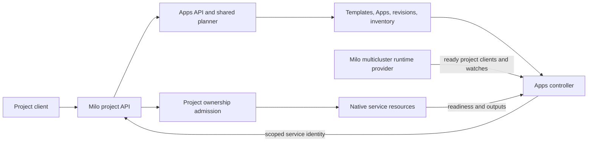
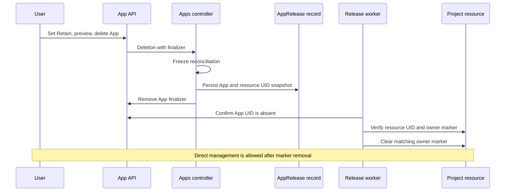

# Apps architecture

This document describes the proposed APIs, project runtime, resource ownership
protection, and graduation flow for [Apps on Datum Cloud](../../../enhancements/experiences/apps/README.md).
It is a design proposal; API names and fields remain subject to review.

## API design

The API uses `apps.miloapis.com/v1alpha1` as a proposed group. Apps coordinates
project resources across services, like other Milo platform capabilities; its
API group does not require its implementation to live in the `milo-os/milo`
repository. The Apps service and schemas remain owned by `datum-labs/apps` and
are served through Milo's normal service API and discovery integration. Names
and field shapes below are for review; service-specific manifests still use
their native APIs. A template may keep its definition and revision history in its
project indefinitely; publication is optional. Every approved `PublishedAppTemplate`
version is stored in one Platform-scoped app repository and discoverable through
the Platform context. This is a logical repository served by the Apps API; its
backing storage is an implementation choice distinct from the `datum-labs/apps`
source repository. There are no organization-scoped Apps, templates, or
catalogs. Apps and plans live in a project. Publication requires a
platform operator's approval. Template use still requires authorization in the
installation project.

| Resource | Purpose |
| --- | --- |
| `AppTemplate` | Project-scoped reusable definition; authoring changes create immutable revisions. |
| `AppTemplateRevision` | Immutable project snapshot of one accepted template definition, used for local installs, history, rollback, and publication. |
| `AppPublication` | Optional project-scoped request to submit an exact template revision for platform operator review. |
| `PublishedAppTemplate` | Platform-scoped, operator-approved immutable version in the app repository, discoverable by all customers. `spec.family` groups versions; `spec.version` identifies one release. |
| `App` | Desired installation pinned to a project template revision or published version, plus inputs. Its status reports the observed deployment. |
| `AppPlan` | Side-effect-free preview of a proposed App create or update. Creating a plan never enables services or creates components. |
| `AppRevision` | Immutable record of an accepted App spec, used for history and rollback. It stores references rather than secret values. |

`AppRelease` is an internal, durable handoff record created when a customer
deletes an App with `Retain`. It is not a second installation.

### Project authoring and catalog discovery

An author creates an `AppTemplate` in a project and declares components,
inputs, bindings, and outputs. Each accepted edit creates an immutable
`AppTemplateRevision` with actor, timestamp, digest, and change provenance.
A project owner can preview, compare, and roll back template revisions without
publishing. Every `App` has a `spec.templateRef` pinned either to an exact
revision of a template in its own project or to an approved Platform version;
there is no inline installation definition. Accepted App spec changes create
separate immutable `AppRevision` records for installation history and rollback.
Changing a template does not alter existing pinned installations.
Keep a pinned project revision available while an App uses it, even if the
authoring template is later deleted; garbage collection waits until no App or
publication references the revision. Deleting the authoring template blocks new
installs from its revisions. A published version retains its own
immutable snapshot independently of the authoring project.

An optional `AppPublication` names an exact template UID, immutable revision,
and content digest, plus proposed family and version. The author
reviews which inputs and references installers must supply. Submission freezes
the request. Validation checks source-project
permission, target API schemas, bindings, required services, reference rules,
and the absence of embedded credentials. The request then enters a Platform
review queue as `PendingApproval`; it is not discoverable or installable.

```yaml
apiVersion: apps.miloapis.com/v1alpha1
kind: AppPublication
metadata:
  name: orders-api-1-0-0
spec:
  templateRef:
    name: orders-api
    uid: "<template-uid>"
  revisionRef:
    name: orders-api-template-r3
    digest: "sha256:<revision-digest>"
  family: orders-api
  version: 1.0.0
# status.phase: PendingApproval; operator decision is written through a
# restricted approval path, never by the submitter.
```

A platform operator reviews the exact digest, validation results, permissions,
and example plan, then approves or rejects with an auditable identity, time,
and reason. Only an operator may record that decision or change a published
version's lifecycle state; the submitter cannot write approval status. Only
the publication controller may create `PublishedAppTemplate` records from approved
requests, so direct API creation cannot bypass review. Before approval, recheck
the frozen digest, source-project eligibility, and current target schemas.
Changing the source template does not change the reviewed snapshot. Approval writes
an immutable `PublishedAppTemplate` to the Platform repository and records its source
project, template UID and revision, submitter, approver, digest, compatibility
requirements, and lifecycle state. A rejected request stays unpublished.

Platform list and get expose approved versions to all customers. An operator
approves or rejects the exact submitted revision; pending and rejected requests
never enter discovery. Plan and install still check project service
availability and installer rights. Unpublished templates and their revisions
remain in their projects. The repository assigns a unique canonical template identity, so
equal display names do not collide. Live App state never becomes the
template's ongoing source of truth.

The repository distributes recipes, not running installations. Every install
creates a new project App UID, revision history, and owned-resource inventory;
the authoring project never owns the consumer's resources. An app company's
public template may request a new instance of its provider-managed service via
the normal Service Catalog entitlement and native service API. The provider
operates that service; the customer controls the App installation and its
project resources. Publication grants the provider no direct write access to
those resources. A new published template version does not silently update
existing installations. Cross-project `appRef` is a separate composition
feature for consuming an existing App's outputs.

Deprecation hides a version from recommended discovery while existing pinned
Apps continue to work. Emergency revocation blocks new installs and upgrades;
existing installations retain the snapshot needed for safe reconciliation,
deletion, and graduation. The source project may be removed without changing
published versions.

An `AppTemplate` or `PublishedAppTemplate` declares typed inputs, required
catalog services, components, and outputs. The project template uses the same
graph schema as the published version; publication adds family, version,
provenance, and approval state. Each component either **creates** a service-native
resource or **references** an existing one. Typed bindings copy an input or another
component's declared output into a field accepted by the target API. Publishing
validates binding types, target schemas, and dependency cycles. This keeps
composition explicit without allowing arbitrary template code. The example
below omits most of the service-native Workload and HTTPRoute specs to focus on
the app contract:

```yaml
apiVersion: apps.miloapis.com/v1alpha1
kind: PublishedAppTemplate
metadata:
  name: web-api-v1
spec:
  family: web-api
  version: 1.0.0
  inputs:
    - name: image
      type: string
      required: true
    - name: gateway
      type: resourceRef
      resourceKind: Gateway
      required: true
    - name: hostname
      type: string
      required: true
  requiredServices:
    - compute.datumapis.com
    - networking.datumapis.com
  components:
    - name: api
      create:
        apiVersion: compute.datumapis.com/v1alpha
        kind: Workload
        # Service-native Workload spec omitted.
      bindings:
        - fromInput: image
          toPath: /spec/template/spec/runtime/sandbox/containers/0/image
    - name: route
      dependsOn: [api]
      create:
        apiVersion: gateway.networking.k8s.io/v1
        kind: HTTPRoute
        # Service-native HTTPRoute spec omitted.
      bindings:
        - fromInput: gateway
          fromField: metadata.name
          toPath: /spec/parentRefs/0/name
        - fromInput: hostname
          toPath: /spec/hostnames/0
        # The backend binding targets the networking service's supported
        # resource for the api component.
  outputs:
    - name: hostname
      type: string
      fromInput: hostname
```

An `App` pins a revision of an `AppTemplate` in its project or an approved
`PublishedAppTemplate` version from the Platform repository. The controller
resolves that immutable snapshot and creates the declared components. Direct resource
inputs include group, kind, name, and scope and resolve within the installation
project.
An `appRef` is one way to supply a template input. The template declares the
resolved value's type, such as `string`; the App input supplies a literal
`value`, an in-project `resourceRef`, or an `appRef` where its declared type
permits it. An `appRef` identifies a producing project, App UID, and output. A
template may restrict which source forms an input accepts. The producer's
template declares the output type, while the producer App grants specific
consumer projects access to that output. The planner checks consumer
authorization and, for cross-project references, the
producer's grant. It records the producer UID, output contract, and observed
output generation in the plan and consumer status, so name reuse or a stale
plan cannot silently retarget a binding.

These references form a directed acyclic graph across projects. For example,
`data/shared-db` can supply an endpoint to `orders/api`, which can supply its
own route to `shop/storefront`. Each App has its own installation, resources,
revision history, and lifecycle. A new dependency is checked against the
current graph at plan and apply time, with a service-maintained dependency index
to avoid a platform-wide scan for every reconciliation. Concurrent edits that
would introduce a cycle must fail one apply. An upstream output change triggers
replanning and reconciliation of affected consumers in dependency order; this
does not create a new `AppRevision` unless the consumer's desired spec changes.
Consumers bind only to ready, type-compatible outputs. Missing or unready
producers, revoked grants, changed output contracts, and cycles set an
actionable blocked condition and pause dependent writes while preserving their
existing owned resources. Deletion never cascades through the graph.

App outputs contain typed, non-secret values or service-defined scoped
references, never credential contents. A declared output needs no separate
`exportable` flag: same-project use follows project authorization, and
cross-project use requires an output grant from the producing App. A consumer
may declare an output derived from its own inputs or components and grant access
to that output. This does not give a downstream App direct access to an earlier
producer; every direct `appRef` is authorized against its named producer. A
producer may change a value within its declared type, while consumers reconcile
under their own authority. Output grants do
not transfer ownership or grant access to upstream Apps further along a chain.

```yaml
apiVersion: apps.miloapis.com/v1alpha1
kind: App
metadata:
  name: orders-api
  namespace: default
spec:
  templateRef:
    source: Platform # Or Project with revision instead of version.
    name: web-api-v1
    version: 1.0.0
  uninstallPolicy: Delete # Set to Retain before deleting to keep owned resources.
  inputs:
    image:
      value: registry.example.com/orders@sha256:...
    gateway:
      resourceRef:
        apiVersion: gateway.networking.k8s.io/v1
        kind: Gateway
        name: shared-edge
    hostname:
      value: orders.example.com
  outputGrants:
    - output: hostname
      projects: [shop]
```

For a project App, `spec.templateRef` uses `source: Project`, the local
template name, UID, and immutable revision name. The template and its history
remain private to that project unless the owner publishes a selected revision.
Editing a template creates a new template revision; an installation adopts it
only after its owner updates the App's pinned reference and reviews a plan.

```yaml
templateRef:
  source: Project
  name: orders-api
  uid: "<template-uid>"
  revision: orders-api-template-r3
```

The controller populates status; clients do not set it:

```yaml
status:
  observedGeneration: 1
  templateVersion: 1.0.0
  currentRevision: orders-api-r1
  conditions:
    - type: Ready
      status: "True"
  components:
    - name: api
      resourceRef:
        apiVersion: compute.datumapis.com/v1alpha
        kind: Workload
        name: orders-api-api
      ready: true
  outputs:
    hostname:
      type: string
      value: orders.example.com
      observedGeneration: 1
```

### Wiring an output into another App

The producer template above declares `hostname` as a `string` output. The
`orders-api` App in project `orders` supplies its value and grants
project `shop` access. Its controller publishes the ready value in
`status.outputs.hostname`. The consumer template declares a normal `string`
input whose source must be an App output:

```yaml
# Relevant fields of the storefront template in project shop.
apiVersion: apps.miloapis.com/v1alpha1
kind: AppTemplate
metadata:
  name: storefront
spec:
  inputs:
    - name: apiHost
      type: string
      required: true
      allowedSources: [AppOutput]
  components:
    - name: storefront
      create:
        apiVersion: compute.datumapis.com/v1alpha
        kind: Workload
        # Service-native Workload spec omitted.
      bindings:
        - fromInput: apiHost
          # Illustrative target; include the env entry in the Workload spec.
          # Planner validation checks this path against the native API.
          toPath: /spec/template/spec/runtime/sandbox/containers/0/env/0/value
```

Here `allowedSources: [AppOutput]` requires an `appRef`, while `type: string`
constrains the resolved output value. A template can also allow both `Value`
and `AppOutput` when the installer should choose between a literal and another
App's output.

The storefront App selects the producing installation and output. The client
can obtain the producer UID while selecting the App; the API requires it in the
accepted reference so deleting and recreating `orders-api` cannot silently
switch the input to a new producer:

```yaml
# Relevant fields of the storefront App in project shop.
apiVersion: apps.miloapis.com/v1alpha1
kind: App
metadata:
  name: storefront-prod
spec:
  templateRef:
    source: Project
    name: storefront
    uid: "<storefront-template-uid>"
    revision: storefront-r2
  inputs:
    apiHost:
      appRef:
        project: orders
        name: orders-api
        uid: "<orders-api-app-uid>"
        output: hostname
```

The planner resolves `apiHost` to `orders.example.com` only after checking the
producer UID, `Ready` condition, output type and generation, consumer access,
and `outputGrants`. The template binding then writes that resolved string into
the storefront Workload field. In short, the value flows from
`orders-api.status.outputs.hostname.value` through
`storefront.spec.inputs.apiHost.appRef` to the template binding's
`fromInput: apiHost`. `AppPlan` reports the producer UID and output
generation; apply rechecks both. A new ready output generation replans the
consumer and updates only its owned resources. If the producer is unavailable,
the grant is revoked, or the output type changes, the consumer reports a blocked
dependency and preserves its existing resources. Its desired App spec and
`AppRevision` do not change merely because the producer's output changed.

The app controller reports `status.observedGeneration`, the resolved template
version or project template revision, conditions (`Accepted`, `Progressing`, `Ready`),
per-component resource references and conditions, and declared outputs such as
the hostname. A condition identifies the failed component and its actionable
reason. Created resources carry a protected App installation UID marker and
appear in the App's
inventory; referenced resources are never adopted.

To preview a change, a client creates an `AppPlan` with `spec.app` containing
the proposed App name and spec. The plan compares it with any existing App of
that name in the project. Its `status` returns the resources to create, update,
or delete; required service enablements; permission or quota failures; and
available cost estimates with their assumptions or an explicit unknown.
Applying the App repeats validation because a plan can become stale. Every
accepted App spec is retained as an `AppRevision` for audit; rollback reapplies
the prior successful template reference and inputs.
Secrets are accepted only as references, never copied into plans, revisions,
status, or generated activity messages.

Updating `spec.templateRef` or `spec.inputs` reconciles
only app-owned components. A failed component leaves the app `Ready=False` with
partial progress visible and can be retried. Deleting an App removes its owned
components after a deletion preview; existing referenced resources and shared
service entitlements remain. Native resource admission, permissions, and
service-specific safety checks still apply to every generated change.

`spec.uninstallPolicy` defaults to `Delete`. An owner can change it to `Retain`
after reviewing a plan that lists every resource to keep, then delete the App.
The App is the installation: there is no separate installation object to leave
behind. Retained resources become directly editable only after that App has
been removed and their ownership markers have been released. A failed release
shows progress and retries; it never silently grants direct control.

## Runtime and reconciliation

Build Apps in the new [`datum-labs/apps`](https://github.com/datum-labs/apps)
repository as a control-plane service that registers the APIs above with Milo
and reconciles project Apps through existing Datum service APIs. The Apps API,
planner, controllers, curated templates, packaging, and service-owned tests
live there. Milo admission changes stay in `milo-os/milo`; the automated
end-to-end environment and Flux deployment fixtures live in
[`datum-cloud/test-infra`](https://github.com/datum-cloud/test-infra). Apps does
not run application traffic or replace the Workload, Networking, DNS, or
managed-service controllers. Milo's [multicluster runtime provider](https://github.com/milo-os/milo/blob/main/pkg/multicluster-runtime/milo/provider.go)
provides project discovery and per-project clients and caches. It watches
ready Projects through the core API and connects to their project control
planes; internal deployments can instead watch ready ProjectControlPlanes and
use service addresses. The Apps controller uses the mode appropriate to its
deployment, scopes each reconciliation to one project, and disengages when a
project becomes unavailable. Cluster engagement must run on every replica,
using Milo's `WithoutAutoStart` and `EngageAlways` wiring until the upstream
leader-election issue is fixed.

Apps deployment manifests live under `datum-labs/apps/config` and use
Kustomize bases, optional components, and environment overlays, following the
relevant layout in [`datum-cloud/compute/config`](https://github.com/datum-cloud/compute/tree/main/config).
The automated test environment consumes an Apps overlay or published Kustomize
bundle through Flux, so tests exercise the same deployment manifests intended
for release.

The service has three parts:

1. **App API and publication:** Validate project template revisions and immutable
   published template versions with the same schema. Check submission rights,
   platform operator approval, target API discovery, typed bindings, dependency
   cycles, reference scope, and secret handling before publication. Require
   target APIs to validate their own resource specs. Templates cannot execute
   scripts or bypass service admission.
2. **Shared planner:** Resolve a pinned project template revision or published version and App inputs into a stable
   component graph. Validate references, project permissions, service
   entitlements, quotas, and service-specific admission. Diff that graph against
   the App's owned resources. Use the same planner for `AppPlan` and controller
   reconciliation; the controller rechecks the plan at apply time. Plans expire
   and are advisory because resources and prices can change.
3. **App controller:** Enable required services through the Service Catalog's
   normal entitlement flow, wait for them to become usable, then apply the graph
   in dependency order. Watch native resource conditions where their meaning is
   known, publish component status and outputs, and retry failed steps with
   backoff. Persist an `AppRevision` for each accepted spec and mark it
   successful only when the App is ready.



The admission path applies to writes of managed native resources. The
controller's inventory and resource UID checks handle ownership across
restarts; the admission guard prevents unauthorized direct writes at the
project API boundary.

Composition should be open to any project resource reachable through Milo's
standard API, subject to project authorization, target admission, and an Apps
service identity scoped to that project. Generic integration provides create,
update, reference, and delete using API discovery and an ownership inventory.
The installer must have permission for the resulting resource actions, or a
project administrator must grant a template-specific install permission; the
controller receives only the corresponding project-scoped rights. Define the
durable delegation behind that statement: record the template version,
component kinds, verbs, project, and authorizing grant for each installation;
check authority on install, spec changes, and later reconciliation. Revoking
the grant must prevent new privileged actions while preserving safe cleanup
or graduation. Privileged kinds such as RBAC and admission policy resources
require an explicit platform allowlist before publication. Generic
integration can report that a resource was accepted, but cannot infer health
or usage cost from an unfamiliar kind. Services can register optional App
capabilities for readiness conditions, outputs, cost estimates, and special
deletion behavior. A required component without a readiness contract leaves
the App's readiness unknown, and a template cannot bind to an undeclared
output. Plans and status show when capabilities are unavailable. Platform
policy may still deny sensitive kinds or cross-project output grants; those are
authorization decisions, not a fixed list of app-capable resources.

Each generated resource gets a stable name and a protected owner marker
containing the App's project and immutable UID. The App stores an inventory of
component GVK, name, namespace, and resource UID so it can detect drift, name
reuse, and partial failures. The marker and inventory must agree before an
update or deletion. On restart, the controller also discovers marked resources
to recover a create that succeeded before its inventory write. A Kubernetes
owner reference alone cannot establish ownership across control planes. Use
server-side apply with a dedicated field manager for the desired fields; field
ownership does not authorize direct customer edits while the App manages the
resource. Referenced resources are checked for access and readiness but never
marked, adopted, or deleted. A cross-project `appRef` consumes only approved
outputs from another App; it does not give the consumer direct access to that
App's component resources. The producer and consumer each retain one owner and
an independent lifecycle. Apps does not grant itself write access in the
producer's project.

## Ownership protection

One App installation owns a resource at a time. The controller refuses to
create over an existing unmarked resource or one marked by a different App.
Future adoption of an existing resource requires a separate, explicit transfer
flow; it is not part of the first release. Only dedicated Apps controller and
release identities may create or remove an owner marker. Project users,
including project admins, cannot update or delete a marked resource directly;
they update the App instead.
Normal status updates and necessary service-controller finalizer writes must
continue through narrowly scoped subresource or service-identity rules. No
general exception for privileged project users or field managers is allowed.

Enforce this at the project API's admission boundary, after authentication and
authorization, for every supported component kind. Check the old object on
update and delete so a client cannot strip the marker in the same request.
Reject marker forgery on create and marker changes by other identities. Give
the Apps controller a dedicated credential with scoped permissions; customers
must not be able to impersonate it. Keep a project-level admission guard
active even when new App installations are disabled, or existing resources
would become unprotected.

A shared CEL `ValidatingAdmissionPolicy` and `Deny` binding could make the
common marker and caller checks local to each API server, with constant policy
count per project rather than one policy per App or component. However,
[Milo currently exposes admissionregistration resources only in Platform
context](https://github.com/milo-os/milo/blob/main/config/discovery/core/discovery-context-policy.yaml),
and [its project control planes are not seeded with
policies](https://github.com/milo-os/milo/blob/main/internal/apiserver/admission/plugin/emailverification/admission.go).
Enabling the plugin alone therefore does not protect project writes. Start
with a small Milo admission guard on project API servers, or first add reliable
per-project policy bootstrap and restricted policy administration. A VAP rollout
must prove policy availability before the API accepts App ownership, fail
closed when policy distribution fails, and measure admission latency and policy
sync at project scale. CEL can inspect the request and old object but cannot
look up the live App, so the controller remains responsible for the ownership
inventory and release state. Recheck any component APIs that bypass Milo's
project admission path before allowing them in templates.

Policy failure behavior needs a separate bootstrap guarantee: Kubernetes
[ignores a binding whose policy is missing](https://kubernetes.io/docs/reference/kubernetes-api/admissionregistration/validating-admission-policy-binding-v1/),
and [admissionregistration resources are exempt from validating admission
policy](https://kubernetes.io/docs/reference/access-authn-authz/validating-admission-policy/).
`failurePolicy: Fail` alone cannot secure a project where the policy or binding
was never installed or was removed. Gate marker creation and project readiness
on a verified guard, protect guard administration with platform authorization,
and independently deny writes to *existing marked resources* while that guard
is absent. If VAP distribution cannot maintain both guarantees, use a compiled
Milo guard for the first release. Exercise startup, reconnection, and deletion
of the policy and binding on a real project API server.

## Graduation and removal

There are two deletion outcomes, shown in the App plan:

1. **Delete resources (default):** The App finalizer deletes owned components
   in reverse dependency order, verifies their resource UIDs, and then removes
   the installation. Referenced resources and shared entitlements stay.
2. **Keep resources:** The user first sets `spec.uninstallPolicy: Retain` and
   reviews the retained inventory, then deletes the App. The App controller
   freezes reconciliation, persists an `AppRelease` record with the exact
   inventory, and removes the App finalizer. The release worker waits until the
   App UID is absent, then clears owner markers only on matching resource UIDs.
   It records per-resource progress and retries failures. A resource remains
   protected until its marker is cleared, and an incomplete release is visible
   for repair. The release record is removed only after all resources are free.



Only the trusted App controller may create an `AppRelease`, and only the
release worker may advance it or clear ownership markers. Persist a snapshot
of the uninstall policy and exact App and resource UIDs before App removal;
customers cannot forge or edit that snapshot. The worker independently checks
the App UID is absent and each resource UID and marker match before release.

The release worker must not apply App templates. This ordering ensures that a
user can take over a resource only after deleting the managing installation;
there is no dual ownership during a partial release. A new App cannot claim a
marked resource. Direct edits and deletes are denied throughout the handoff
until each resource is released. The release record is durable and separate
from the deleted App so retries survive controller restarts and App garbage
collection. Retaining a stateful component keeps its data but does not promise
the App's former readiness or connectivity after graduation.
An App may be removed even when another App consumes one of its outputs; there
is no cascading deletion or implicit finalizer on the producer. Deletion
preview lists known consumers where the caller may see them, and consumers
report a missing dependency after removal. The producer's output grant is
removed with it. A replacement App using the same name has a different UID
and requires the consumer to accept a new reference.

Default deletion runs the graph in reverse dependency order and keeps the App
finalizer until owned resources are removed or a clear intervention condition
is set.
Shared service entitlements remain enabled. Rollback selects a prior successful
revision and reconciles its desired spec; it cannot undo external side effects
or stateful data changes. A failed rollout preserves the previous revision
record and exposes exactly which component needs attention.

## Scale and rollout checks

Apps add several customer-facing API types, an internal release record, and API
calls proportional to component count. Bound template size and plan work,
rate-limit reconciliation per project, and restrict per-project caches to
needed resource kinds. Milo's provider currently registers project control
planes serially; measure project engagement time, memory, watch count, and API
request rates before expanding adoption. Ownership admission must use request
metadata and identity without per-write App lookups. Measure deny rate and
latency separately from reconciliation work.

Before enabling a component kind, verify that all writes pass through the
project ownership guard and that its normal status and finalizer updates still
work. Test controller restart, a create that succeeds before inventory is
written, project disconnection, name reuse, partial deletion, and partial
release. Keep reconciliation and release enabled when new installations are
disabled.

## Open question

Can project policy bootstrap and administration meet fail-closed availability
and latency targets, allowing the ownership guard to move from a Milo plugin
to one shared validating admission policy and binding per project?
