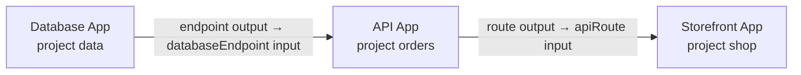
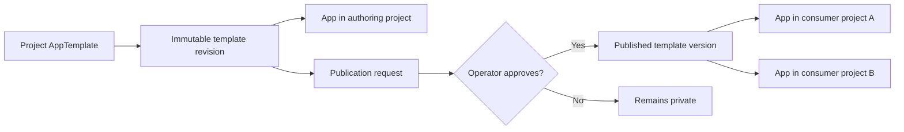

# Apps

## Summary

Apps give customers one place to deploy and manage a complete application on
Datum Cloud. An **App** is a project-scoped installation of a versioned
**App Template**. Authors can keep templates private to a project or submit a
version for publication. A customer reviews the resources and
expected costs, then deploys. Datum shows one app-level view of readiness,
endpoints, usage, and changes across the underlying resources.

The first use case is a web API: a Workload, an HTTP route through a Gateway,
a domain, and an optional connection to a managed service. The same model should
also support simpler apps, such as a Function with a public endpoint, as those
services become available.

## Motivation

Customers currently assemble compute, networking, DNS, and service connections
one resource at a time. They must understand creation order, carry values
between services, and inspect several pages to answer whether their application
is ready. Repeating a known deployment is especially tedious. Service providers
also lack a way to turn a working combination of capabilities into a repeatable
customer experience.

The Service Catalog helps customers
discover and enable individual services. App Templates build on those services
to describe a working application; they do not create a new service type or
replace the services' own APIs.

Teams should be able to turn an application they have tested in a project into
a reusable offering that other projects can discover and install.

### Goals

- Deploy a useful multi-resource application through one guided flow or a
  declarative request.
- Let authors compose Datum resources through explicit inputs and outputs.
- Give customers one app-level view of deployment progress, failures, endpoints,
  component resources, and estimated and actual spend.
- Make updates, rollbacks, and deletion predictable while keeping each
  underlying resource inspectable in its native service.
- Let an App consume approved outputs from another App without changing either
  App's ownership or lifecycle.

### Non-Goals

- A general-purpose infrastructure language or arbitrary scripts in templates.
- Automatically migrating application data or rolling back stateful services.
- Creating and owning resources in more than one project from one App installation.
- Hiding native resource controls from advanced users.
- A storefront or payment system for third-party apps in the first release.

## Proposal

### Product model

| Concept | Customer meaning |
| --- | --- |
| App Template | A project-authored, versioned recipe with a description, required services, configurable inputs, components, outputs, and an upgrade path. Approved versions can be published to the Platform repository. |
| App | One project installation pinned to a project template revision or published version, with its own inputs and owned resources. |
| Component | A Datum resource created by the app, or a reference to an existing resource or managed service in its project. |

A template can connect components by passing declared
outputs into later inputs, such as a Workload's service endpoint into an HTTP
route. It can ask for an existing network or domain instead of creating one.
Templates use Kustomize-style replacements to connect typed inputs and earlier
component outputs to resource fields. Named list selectors keep these bindings
stable when authors reorder containers or environment variables.
The definition declares which components it owns; referenced resources remain
under their existing owners. Required service enablement uses the Service Catalog's entitlement
flow, with dependencies and price implications shown before deployment.
Templates group related inputs and can define explicit choices. For example,
choosing public exposure requires a Gateway and hostname, while private
exposure omits those fields and the public route. The configure flow shows the
selected fields, and the plan shows the resources that choice creates or removes.

Apps can form chains: a database App exports an endpoint to an API App, which
exports its route to a storefront App. Each installation binds a typed input to
a declared output of another App, including an unpublished App in another
project. The producing App grants access to specific outputs across projects;
every link is authorized separately. The plan shows the dependency chain and
readiness of each upstream App. When an output changes, dependent Apps
reconcile in order. If an upstream App is unavailable or its grant is revoked,
affected Apps report a blocked dependency and preserve their existing resources.
Customers can find granted outputs from their project without browsing the
producer's private App or its resources. Offers show the output's identity,
type, and readiness; resolving its value still requires authorization. A
consumer's rollback restores its own prior configuration using current upstream
values. Revoking a grant stops future updates but does not erase a value already
written to a consumer-owned resource.
Each App manages only its own resources. Deleting an App does not delete its
consumers or producers. Direct resource references remain available within an
App's project.

Each arrow is a separately authorized output binding. The three Apps are
independent installations with separate resources and deletion lifecycles. The
consumer App's `appRef` selects the producer's declared output; the consumer
template binds the resolved value into one of its components.

### Author and publish

An author can define a template, retain its revision history, and install
instances entirely within one project. Each App also keeps installation
revisions for input changes and rollback. If the author later wants reuse
elsewhere, they submit one template revision for publication. A platform
operator reviews that exact snapshot and approves or rejects it. Only approved
versions enter the platform app repository and become discoverable. The source
project and revision remain as provenance, but installations depend on the
immutable published version. Installation values and secret contents never
enter the repository.
The create flow may author a private template and its first App together, so a
one-off deployment does not require a separate manual publishing step.

The authoring App is optional. Publication distributes the template snapshot;
each consumer deploys a new App with its own inputs and resources.

Platform discovery shows approved versions from the single repository, with
their source, version, required services and permissions, outputs, and lifecycle
state. Every approved published version is discoverable platform-wide.
Unpublished templates and their revision history remain in their projects.
Publishing a new version does not
change existing installations.

A team can submit a recipe for platform publication so colleagues and other
customers can install separate Apps in their own projects. An app company
can publish a recipe for customers to install as separate Apps in customer
projects. Each installation has its own
inputs, resources, revisions, and deletion lifecycle. If the recipe uses a
provider-managed service, the provider operates that service through its native
API while the customer controls their App installation. Cross-project `appRef`
inputs connect existing Apps; they do not distribute or clone an App.

### Customer experience

1. **Start:** Author or select a project template, or browse published templates by use
   case, services, required permissions, resources, and pricing dimensions.
2. **Configure:** Select a project, name the app, choose a deployment location,
   provide a container image or artifact, and fill in the App's inputs.
   Secret values are supplied through secret references.
3. **Preview and deploy:** Review the resource plan, new service enablements,
   external resources the app will use, and estimated recurring cost. Deployment
   reports progress per component and gives a useful error when action is needed.
4. **Operate:** Open the app to find its endpoint, health, recent activity,
   component resources, and costs. Update its inputs or select a newer project
   template revision or published version after reviewing the resulting plan.
   Revert to a prior successful installation revision when an update fails.
5. **Delete:** Preview what will be removed. If the App or its resource inventory
   changes before deletion, review a fresh preview. App-owned resources are deleted;
   referenced resources and shared service entitlements are retained. Choose
   **keep resources** before deletion to graduate owned resources to direct
   management after the App installation is gone. Track cleanup or release
   progress after the App disappears.

For example, a team selects **Web API**, chooses an image and domain, and
deploys. The app creates a Workload and route, connects the route to the chosen
domain, and reports a single URL and readiness state. If a managed database is
part of the recipe, the team can choose an existing database or request a new
one, subject to that service's availability and permissions.

### Initial scope

- Support project templates and their local App installations alongside the first platform-curated template, then
  enable operator-reviewed publication from customer projects once validation
  and approval are proven.
  Start with Workload, Gateway/HTTP route, domain, and references to existing
  services; add Function and new managed services as they mature.
- Publish immutable template versions when reuse is wanted. Existing template
  installations stay on their selected version until an owner chooses an update;
  project templates and App installations keep their own revision histories.
- Validate inputs and permissions, show a plan, reconcile created resources,
  and expose partial failure and retry at the component level.
- Record app ownership on created resources so updates and deletion can
  distinguish them from referenced or manually created resources, and prevent
  direct changes while the App manages them.

### Success measures

- A new customer can deploy the Web API example and reach a working endpoint
  without manually creating its component resources.
- The app page explains which component blocks readiness and links to that
  resource for diagnosis.
- Customers can preview and complete an app update or deletion without losing
  referenced resources.
- Customers can keep an App's resources when removing it, then manage those
  resources directly with no period of simultaneous App and customer control.
- Track deployment completion, time to first healthy endpoint, failed steps,
  template reuse, and update or rollback rates.

### Risks and Mitigations

- **Privilege escalation:** Validate installer permissions and run reconciliation
  with project-scoped rights; every generated resource still passes its native
  admission checks.
- **Unexpected deletion or drift:** Track created resource identities, never
  adopt references, preview destructive changes, and reconcile App resources
  against their declared spec.
- **Incomplete service signals:** Show unknown readiness or cost explicitly
  when a service has not published the corresponding App capability.

## Design Details

### API and ownership contract

The proposed API stores project-scoped `AppTemplate` definitions and immutable
`AppTemplateRevision` history. Operator-approved, immutable
`PublishedAppTemplate` versions live in one Platform-scoped repository, with
source attribution and operator-controlled lifecycle state. Every project-scoped
`App` pins one template revision or published version; `AppPlan` previews are
side-effect-free, and `AppRevision` records installation changes. Templates
declare the resources they create or reference, typed inputs and outputs, and
required services. A
plan shows expected resource changes and available cost estimates before the
App is applied. A delete plan shows exact resource actions and the chosen
uninstall policy. Its preview is advisory; deletion rechecks App identity and
current state. A customer-readable release record reports cleanup and
graduation progress after deletion.

An App owns only resources it creates. Customers change those resources through
the App while it is installed; existing referenced resources remain under their
current owners. On deletion, customers can remove owned resources or choose to
keep them. Kept resources become directly manageable after the App installation
is removed. The [Apps architecture](../../../architecture/experiences/apps/README.md)
defines the API shapes, Milo multicluster runtime, admission enforcement, and
release sequence that preserves single ownership.
References pin resource and App identities so a recreated same-name dependency
cannot be selected silently. Templates may project authorized non-secret
reference fields; credential contents remain opaque native secret references.

### Delivery sequence

1. **First vertical slice:** A project Web API template and App installation, and one platform-curated
   Web API template, each using a Workload, an existing Gateway, and an HTTP
   route. Ship project `AppTemplate`, `PublishedAppTemplate`, `App`, a shared planner, and ownership admission
   through API and CLI before adding a template gallery. Resolve the
   Workload-to-route backend contract with Networking first.
2. **Safe lifecycle:** Add plans, component status, deletion, retention and
   release, immutable revisions, and rollback. Verify
   direct update/delete denial, marker forgery, status and finalizer exceptions,
   name reuse, partial failure, retry, drift, and preservation of referenced
   resources in end-to-end tests.
3. **Broader composition:** Allow operator-approved publication from customer
   projects after validation is proven. Add cross-project App output references and richer
   readiness, outputs, and cost estimates as services publish App capability
   contracts.

The first release succeeds when a project owner can preview, deploy, inspect,
update, and remove both a private-template and curated Web API without manually
coordinating their component resources.

### Open decisions

- Which components should the first curated template create versus require as
  existing resources, particularly domains and Gateways?
- What cost estimate is useful and reliable before deployment when service usage
  depends on traffic?
- Which networking resource should an HTTPRoute target for a Workload component,
  and what output should that component expose to the template?

## Production Readiness Review Questionnaire

### Feature Enablement and Rollback

Enable Apps by project during the initial rollout; existing resource behavior
does not change. Disabling new installs must leave reconciliation and deletion
available for existing Apps. Reenabling resumes normal reconciliation from the
stored App spec and resource inventory.

### Rollout, Upgrade and Rollback Planning

Roll out the private-template and curated Web API flows to pilot projects. Template
versions are immutable, so publishing a new version does not alter existing
Apps. Keep the controller compatible with stored revisions during upgrades and
rollbacks.
Block broader rollout if ownership, deletion, or status reporting fails in the
pilot; test controller restart and upgrade, downgrade, upgrade paths.

### Monitoring Requirements

Operators need counts of Apps by condition, plan validation failures,
reconciliation lag, retry rates, and dependency-blocked Apps. Customers see
per-component conditions, resource links, outputs, and activity. Set numeric
plan latency and time-to-ready objectives before this proposal becomes
implementable.

### Dependencies

Apps depend on Milo project APIs and IAM, the Service Catalog entitlement flow,
and the native APIs used by each template. The first template also depends on a
defined Workload-to-route backend contract. Cost estimates and richer readiness
depend on service-published capability contracts.

### Scalability

Plans and installs must remain responsive as projects and apps grow. Bound
template size, rate-limit reconciliation per project, and establish scale
targets for project onboarding and admission latency before broad rollout.

### Troubleshooting

An unavailable API or service pauses the affected component and retries without
discarding known state. App conditions identify the blocked component, reason,
and last transition; the inventory and audit events show which native resources
were changed. Operators can inspect the linked resource in its owning service.

## Implementation History

No implementation milestones yet. This section will track delivered work as
the proposal moves through implementation.

## Drawbacks

Apps add a controller and a cross-service lifecycle to operate. Plans cannot
guarantee a transaction across services, and some resource kinds cannot provide
meaningful health or cost signals without an additional capability contract.

## Alternatives

- **Client-side manifest bundles:** Simple to publish, but no durable App status,
  ownership, or safe update and deletion flow.
- **One App API per service:** Keeps service-specific logic local, but makes
  multi-service deployment and a unified customer view difficult.

## Infrastructure Needed (Optional)

An Apps API and controller, storage for templates, Apps, plans, revisions, and
release records, project-scoped service identity, and project API ownership
admission are required. Existing services continue to own their runtimes and
data planes.
