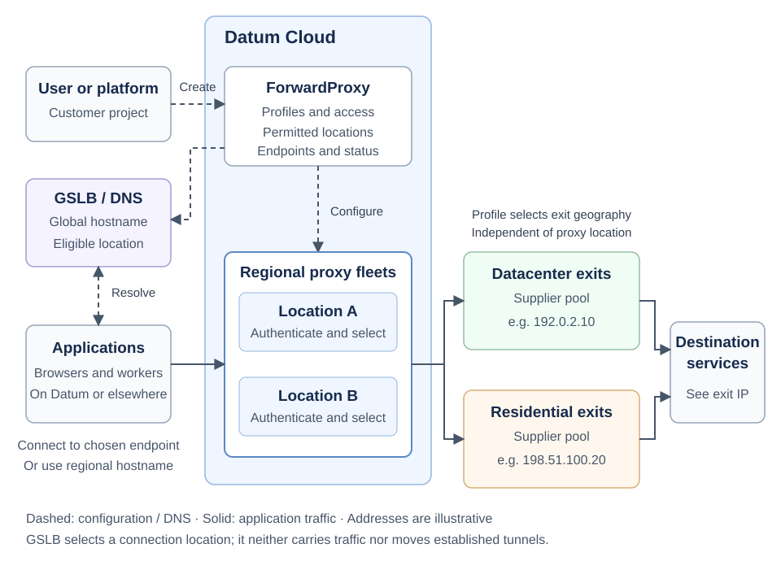

# Managed forward proxies

- [Summary](#summary)
- [Motivation](#motivation)
- [Proposal](#proposal)
  - [User stories](#user-stories)
  - [Using a forward proxy](#using-a-forward-proxy)
  - [Choosing egress IPs](#choosing-egress-ips)
  - [Customer and platform responsibilities](#customer-and-platform-responsibilities)
- [Design details](#design-details)
  - [Architecture](#architecture)
  - [Global and regional endpoints](#global-and-regional-endpoints)
  - [API direction](#api-direction)
  - [Access and lifecycle](#access-and-lifecycle)
  - [Existing foundations and missing capabilities](#existing-foundations-and-missing-capabilities)
- [Delivery and acceptance](#delivery-and-acceptance)
- [Production readiness](#production-readiness)
- [Drawbacks and alternatives](#drawbacks-and-alternatives)
- [Open decisions](#open-decisions)
- [Infrastructure needed](#infrastructure-needed)
- [Implementation history](#implementation-history)
- [References](#references)

## Summary

Datum Cloud will let users deploy an authenticated forward proxy in their project
and choose the public IP characteristics of its outbound traffic. Applications
connect to a stable proxy endpoint; destination services see an egress IP from
the selected residential or datacenter offering rather than the application's
ordinary outbound address.

A global hostname uses DNS-based global server load balancing (GSLB) to direct
clients toward nearby, healthy proxy locations. Regional endpoints remain
available for customers who need explicit placement. Proxy-location routing is
independent of the exit geography selected by an egress profile.

A deployment is reusable across workloads and customer tenants. It does not
require a new proxy instance or API resource for every browser session or
connection. Datum operates the proxy service and integrates with IP suppliers;
customers retain control of their applications and tenant relationships.

This is a product proposal, not an implemented API or production capability.
The first delivery uses supplier-backed residential and datacenter exits. It
does not depend on building a residential network or adding dedicated exit-IP
selection to Galactic.

## Motivation

Browser platforms, automation services, and testing systems need to make
outbound connections from selected locations and IP types without operating
proxy fleets or integrating each supplier themselves. An application's hosting
location should not dictate its outbound identity.

Datum already provides reverse proxying and network connectivity. A managed
forward proxy adds a customer-controlled outbound path that works for workloads
on Datum and elsewhere.

### Goals

- Offer a persistent proxy endpoint with authenticated, project-scoped access.
- Provide global routing across eligible locations while retaining regional endpoints.
- Let users select residential or datacenter exits and available geographies.
- Make exit-IP stability, availability, and usage understandable to customers.
- Support many workloads through one logical deployment without exposing supplier
  credentials or infrastructure details.
- Keep the service useful to browser platforms and other HTTP clients alike.

### Non-goals

- Managing browser sessions, fingerprints, navigation, or application retries.
- Requiring Datum accounts or resources for every customer's downstream tenant.
- Transparent traffic interception, broadcast relay, or TLS interception.
- SOCKS5, UDP, or IP tunneling in the first delivery.
- Moving or renaming the existing `HTTPProxy` resource as part of this release.
- Building an owned residential network or promising unrestricted destination access.

## Proposal

### User stories

- A browser platform creates a proxy once, then connects many browsers using
  credentials authorized for the appropriate outbound option.
- A testing service uses the same deployment to access a website through German
  residential and US datacenter exits without relocating its workers.
- A customer needing a stable source IP can see whether the offering supports
  that requirement before relying on it for a workflow or destination allowlist.
- An operator can revoke compromised access, explain provider failures, and
  attribute usage without inspecting application payloads.

### Using a forward proxy

1. **Create a deployment.** The user creates a `ForwardProxy` in their project
   and selects outbound options. Datum reports whether the configuration is
   accepted and when the endpoint and each option are ready.
2. **Authorize access.** The user obtains proxy credentials scoped to the
   deployment and an allowed outbound option. Credentials may be shared within
   a trusted service or separated for workload isolation and revocation.
3. **Configure applications.** The user supplies the endpoint and credentials
   through the client's normal proxy settings. A global hostname resolves to an
   eligible regional proxy endpoint; a regional hostname stays within the chosen
   region. There is no Datum API call for every destination request.
4. **Connect through an exit.** Datum authenticates the connection, applies
   destination restrictions, and forwards it through the selected supplier.
   The destination sees the supplier's exit IP, not the proxy endpoint's IP.
5. **Operate and release.** The user inspects readiness and usage, rotates or
   revokes credentials, and deletes the deployment when it is no longer needed.

A browser platform such as Browserbase keeps its own mapping from tenants and
browser sessions to proxy credentials and outbound choices. Datum authorizes
the credential; a customer-supplied tenant label is not proof of authority.

### Choosing egress IPs

An **egress profile** is a named outbound choice within the deployment, such as
German residential or US datacenter. It describes requirements, not a supplier,
separate proxy instance, reserved IP, or tenant. Several profiles may share a
serving fleet and backing pool.

The proxy endpoint is where the client connects. An egress IP is the source
address the destination observes. Serving location and exit geography are
separate choices; a nearby proxy endpoint does not establish a nearby exit.

The product must distinguish three behaviors:

- **Shared exits:** The supplier selects an eligible address. Different
  connections using one profile may have different IPs; exclusivity is not promised.
- **Sticky exits:** An optional, scoped affinity key groups connections onto one
  supplier assignment for a supported duration. The customer chooses whether
  that grouping represents a tenant, workload, or session. Stickiness is not
  ownership or exclusivity, and an expired key does not guarantee the old IP.
- **Reserved exits:** An explicit assignment retains a specific address for its
  advertised lifetime. Any exclusivity guarantee must be stated separately.
  This capability is offered only after reservation, release, and supplier
  behavior are qualified; it is not a first-delivery dependency.

Unsupported geography or stability requirements fail explicitly. No profile
silently falls back to direct access or another geography. Where strict sticky
behavior is supported, loss of the assigned exit fails affected new connections
instead of silently changing IP. Established tunnels can break; Datum does not
promise to migrate them or replay application traffic.

Status exposes available capabilities and assigned addresses where a real
reservation exists. A shared or rotating profile must not advertise one sampled
address as its permanent egress IP. An affinity key is scoped to authenticated
access and the profile so another customer cannot claim the assignment.

### Customer and platform responsibilities

Customers own application configuration, tenant permissions, domain-routing
decisions, and recovery from connection failures. Browser-specific DNS, WebRTC,
and identity configuration remain the browser platform's responsibility.

Datum owns proxy authentication, supplier integration, traffic isolation,
destination restrictions, infrastructure health, and attributable usage.
Supplier credentials remain private. Choosing a new supplier must preserve the
accepted profile and any active stability commitments, or report failure.

Explicit proxy configuration is not a guarantee that all workload traffic uses
the service. Proxy-only network enforcement is a separate capability for Datum
workloads, not a prerequisite for using the endpoint. Customers running elsewhere
must enforce their own network boundary.

## Design details

### Architecture



The diagram shows the proposed product boundary. Solid arrows carry application
traffic; dashed arrows represent configuration or DNS resolution, not tunnel
traffic. IP addresses are documentation examples, not available inventory or
guaranteed assignments.

- **Project API:** Holds the logical deployment, profile requirements, and
  authorized access. Status separates accepted configuration from serving readiness.
- **GSLB and DNS:** Publish the global hostname using eligible regional endpoints
  and location health. DNS helps clients choose a connection endpoint; GSLB is
  not another forwarding hop and does not select the supplier's exit IP.
- **Forward-proxy deployment:** A separately operated Envoy fleet authenticates
  requests and selects an authorized upstream path. One logical customer
  deployment does not imply dedicated physical infrastructure or one Envoy per
  tenant. Forward and reverse proxy workloads have independent lifecycle and
  resource budgets; isolated microVMs may share physical hosts.
- **Supplier integration:** Translates profiles and optional affinity into supplier
  connection parameters and normalizes failures. Residential and datacenter
  profiles initially use supplier-backed pools. The supplier assigns the public
  exit IP; profile selection alone does not allocate a Galactic address.
- **Networking:** Provides connectivity to the fleet and suppliers. An owned
  datacenter pool could later use Galactic exit infrastructure, but would require
  explicit pool selection, address assignment, and return-path guarantees.

The gateway creates a new upstream connection after accepting the client
connection. The profile must therefore govern that upstream path; merely labeling
the original workload or an Envoy cluster does not select a network-side NAT pool.

### Global and regional endpoints

The global endpoint prefers a nearby healthy location within the customer's
permitted serving locations, subject to capacity and policy. DNS proximity is
approximate: resolver placement and available client-location signals can affect
the decision. A browser in Virginia may connect to a nearby Datum proxy while
its German residential profile still selects an exit in Germany.

A location is eligible only when the listener, global-hostname TLS identity,
authorization configuration, capacity, and required supplier paths are ready.
DNS cannot inspect proxy credentials or affinity keys. Every location advertised
for a shared global hostname must support its enabled profiles; if there is no
common eligible location, report the global endpoint unavailable rather than
silently routing to a location that cannot honor the selection. Regional endpoints
report their own profile capabilities and do not fail over outside their region.

Removing an unhealthy location changes future DNS answers, not cached answers or
established CONNECT tunnels. Clients reconnect and retry under their own policy.
Planned drains account for DNS cache lifetime and existing connections; gateway
checks still reject unauthorized or unsupported requests arriving on stale answers.
If no location qualifies, global DNS must not deliberately return an ineligible
location as a last-resort fallback. Exact TTLs, health thresholds, and no-endpoint
responses remain implementation decisions.

Credentials and revocation must be effective across all eligible locations.
Sticky or reserved exit guarantees must also survive reconnection to any of them;
otherwise those guarantees require regional access and are rejected on the global
endpoint. GSLB cannot preserve exit identity by itself. The controller exposes
global and regional endpoint readiness separately, including DNS publication and
the reason a location is excluded.

### API direction

Introduce `ForwardProxy` under a proposed `proxy.datumapis.com` group. Keep
profiles embedded initially and avoid a public resource per application session.
The following selected fields illustrate intent; they are not an apply-ready CRD
schema or a commitment to credential, placement, or status field names.

```yaml
apiVersion: proxy.datumapis.com/v1alpha
kind: ForwardProxy
metadata:
  name: automation
spec:
  profiles:
    - name: german-residential
      egress:
        type: ManagedResidential
        geography:
          country: DE
          fallback: None
    - name: american-datacenter
      egress:
        type: ManagedDatacenter
        geography:
          country: US
          fallback: None
```

The initial service offers an authenticated TLS-protected endpoint, ordinary
HTTP forwarding, and TCP tunnels through HTTP CONNECT, initially restricted to
approved web destination ports. TLS inside a tunnel remains between the client
and destination. A port restriction alone does not prove the tunneled protocol
is HTTPS. No anonymous mode is offered.

Credentials select an authorized profile in the simplest integration. Reuse
platform identity and secret-management mechanisms where suitable; a separate
credential resource is an implementation decision, not a required tenant model.
Supplier identifiers and Galactic shard selectors are not customer API inputs.

The API must express whether global access is enabled and which serving locations
are permitted. Status returns the global hostname, regional hostnames, and their
readiness separately from exit-IP information. The exact fields and GSLB resource
integration are deferred; customers should not configure Envoy addresses or DNS
records manually to use the global endpoint.

### Access and lifecycle

Credential and project isolation apply before upstream selection, connection
reuse, and accounting. Private endpoint integration must also handle overlapping
VPC addresses; source IP alone is not customer identity.

Revocation and deletion stop new admissions and terminate or drain existing
tunnels under a documented, bounded policy. A security suspension must support
closing active tunnels. Cleanup releases supplier reservations where applicable
and completes even when the customer deletes its project. Profile changes cannot
silently weaken active exit-identity commitments.

Readiness reports endpoint availability and profile-specific blockers such as
unavailable geography, exhausted capacity, or provider authentication failure.
It does not guarantee access to every website. Usage records distinguish project,
deployment, profile, and credential without exposing secrets or application bodies.

### Existing foundations and missing capabilities

The existing [HTTPProxy API](https://github.com/datum-cloud/network-services-operator/blob/88c43b0392eca0446ca38167167ebc8f518b37d1/api/v1alpha/httpproxy_types.go) manages
reverse proxying. The [internet access design](https://github.com/datum-cloud/network-services-operator/blob/88c43b0392eca0446ca38167167ebc8f518b37d1/docs/enhancements/internet-egress.md) and Galactic
provide ordinary outbound connectivity and policy primitives. The
[internal DNS integration](https://github.com/datum-cloud/network-services-operator/blob/88c43b0392eca0446ca38167167ebc8f518b37d1/docs/enhancements/internal-dns/README.md) provides a reusable pattern
for private service access. None is already the managed forward-proxy offering.

The new work is an authenticated forward-proxy fleet, supplier adapters, profile
resolution, access lifecycle, outbound usage attribution, and GSLB endpoint and
health integration. Global DNS routing is a proposed dependency, not an existing
forward-proxy capability. Existing reverse proxy
[metering work](https://github.com/datum-cloud/network-services-operator/blob/88c43b0392eca0446ca38167167ebc8f518b37d1/docs/enhancements/http-metering/http-traffic-metering.md) is a foundation,
not evidence that CONNECT usage or supplier-bill reconciliation is implemented.
Proxy-only enforcement and Datum-owned dedicated exits need additional network
work and can follow independently.

## Delivery and acceptance

Start with persistent authenticated endpoints, supplier-backed residential and
datacenter profiles, country selection, shared exits, and project-level usage.
Regional endpoints establish the initial serving path. Enable the global hostname
after multi-location health, DNS publication, and identity guarantees are qualified;
GSLB unavailability must not prevent use of otherwise healthy regional endpoints.
Qualify optional stickiness against the selected supplier before advertising it.
Reserved exits, private endpoints, and proxy-only network enforcement have
separate capability gates; unsupported requests are rejected rather than ignored.

Before production, demonstrate that:

- Two projects can use the same fleet without sharing authorization or access to
  each other's credentials and assignments.
- A client selects an authorized profile and a controlled destination observes
  its qualifying exit IP, not the customer's ordinary outbound address.
- Invalid credentials, disallowed destinations, and unsupported selections fail
  without a direct or cross-profile fallback.
- Several connections and gateway replicas respect any advertised affinity
  guarantee, including expiration and supplier failure.
- Global DNS selects only eligible permitted locations, including when a location
  loses supplier connectivity or support for an enabled profile.
- Location loss, DNS caching, draining, and reconnection preserve the selected exit
  policy without promising migration of an existing tunnel. Regional access does
  not silently leave its region, and global access fails closed when none qualify.
- Cross-location reconnects preserve credential scope, revocation, and any
  advertised exit affinity; unsupported global stability combinations are rejected.
- Credential revocation and project deletion close access within the documented
  bound and do not strand provider cleanup obligations.
- HTTP requests, HTTPS tunnels, parallel connections, and long-lived connections
  behave correctly through the supplier, with both target address families tested.
- Usage survives gateway restarts and is reconciled against a defined byte-counting
  boundary and supplier records; secrets are absent from logs and status.

## Production readiness

Launch requires supplier terms that permit the offering, acceptable-use and abuse
handling, account limits, and a tested response to supplier outages. Destination
restrictions must cover private, loopback, link-local, metadata, and translated
address forms, including destinations resolved by the supplier. A local hostname
check alone does not establish the safety of a remote resolution.

Bound connection counts, idle time, bandwidth, authorization load, and retries.
Spread serving replicas across hosts and keep ingress capacity independent of
forward-proxy demand. Establish measured availability and latency targets before
promising an SLA; this proposal sets no unmeasured performance or price targets.

Operators need regional endpoint and supplier health, global DNS publication and
location eligibility, authorization failures, connection counts, usage-delivery
lag, and cleanup backlog. Billing must state which bytes
are charged and how failed attempts are treated. Provider destination restrictions
must be visible to customers rather than presented as unexplained gateway failures.

A rollout pause stops new provisioning without silently changing existing exit
identities. Control-plane outages must not grant new access; any cached access has
an explicit expiry and revocation bound. Rollback must preserve cleanup and usage
records until outstanding obligations are settled.

## Drawbacks and alternatives

The service adds a network hop, supplier dependence, and operational responsibility
for an authenticated public proxy. Geography, reputation, and IP stability depend
on the selected offering and cannot be inferred from the proxy's serving location.

Customers could integrate suppliers directly, but would then own provider-specific
configuration and operations. Separate deployments per profile simplify selection
but multiply customer endpoints; embedded profiles keep a reusable endpoint.
Transparent interception reduces client configuration but adds destination recovery,
protocol handling, and network enforcement requirements outside this release.

## Open decisions

- Which supplier offerings qualify for country selection, optional stickiness,
  permitted destinations, address families, and eventual reserved exits?
- Which platform credential mechanism supports proxy clients, safe rotation,
  profile scoping, and bounded revocation without a mandatory tenant resource?
- What are the serving locations, capacity tiers, usage units, and commercial terms?
- Which GSLB interface owns global DNS publication, health inputs, permitted-location
  policy, TTLs, drains, and the no-eligible-endpoint response?
- What exact mutation, drain, affinity-expiration, and project-cleanup contracts
  must the implementation provide?
- When should private access, owned datacenter exits, or additional proxy protocols
  be qualified, without making them prerequisites for the initial service?

## Infrastructure needed

An independently deployable forward-proxy fleet, authorization and configuration
services, protected supplier credentials, supplier accounts, and a durable usage
pipeline are required. Global access also requires authoritative DNS and GSLB,
regional health reporting, and certificates valid for the global hostname at each
eligible listener. Qualification needs at least two serving locations and two
customer projects, controlled destination servers, and fault injection for gateway, authorization,
and supplier failures. No dedicated physical host per customer is required by
this product contract.

## Implementation history

- 2026-11-17: Drafted the product contract and lightweight architecture. No APIs,
  controllers, or serving configuration are implemented by this enhancement.
- 2026-11-17: Added global DNS routing, regional endpoint access, and the separation
  between proxy-location failover and exit-IP guarantees.

## References

- [GSLB architecture proposal](../traffic-intelligence/gslb-jamie-tartt.md), the related global routing design.

- [Fleet machine lifecycle enhancement](https://github.com/datum-cloud/fleet/blob/4330daf6476ac1a6d406974f2722caaf266ee4fc/docs/enhancements/machine-lifecycle/README.md), the structure and product-contract reference.
- [Envoy CONNECT support](https://www.envoyproxy.io/docs/envoy/latest/intro/arch_overview/http/upgrades).
- [Browserbase proxy documentation](https://docs.browserbase.com/platform/identity/proxies), an example consumer capability set rather than a dependency on Browserbase internals.
