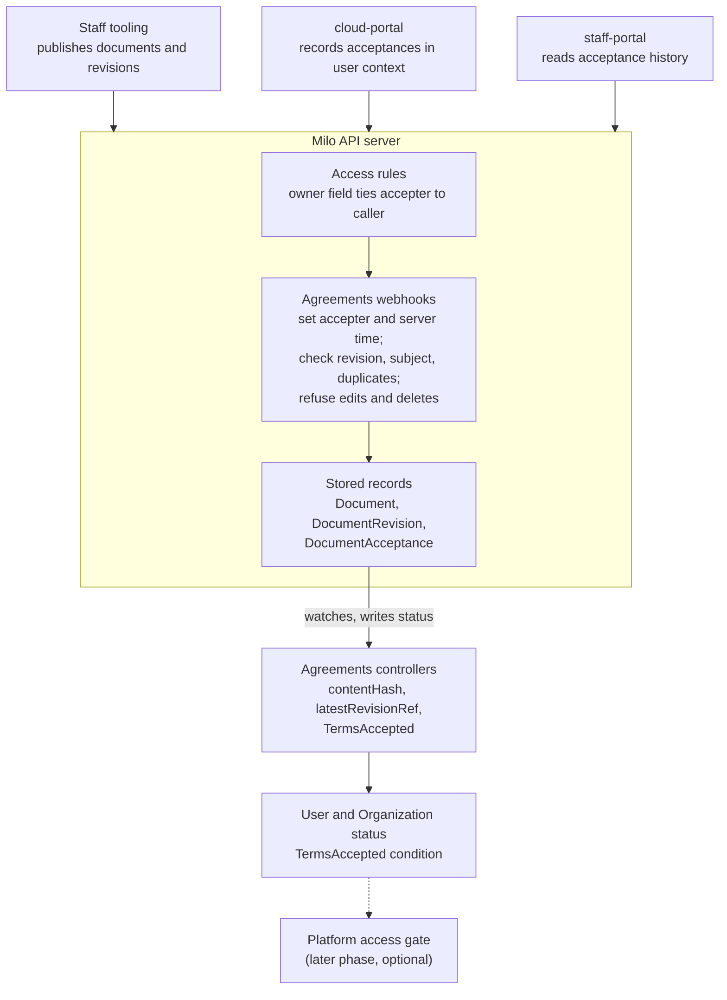
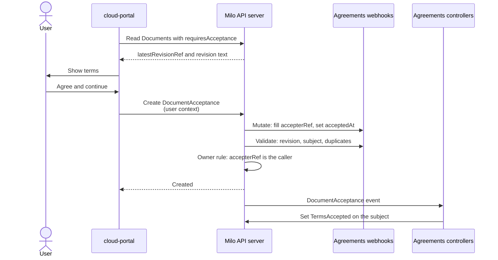

# Agreements System

- [Agreements System](#agreements-system)
  - [Summary](#summary)
  - [Motivation](#motivation)
    - [Goals](#goals)
    - [Non-Goals](#non-goals)
  - [Proposal](#proposal)
    - [Background](#background)
    - [Notes/Constraints/Caveats](#notesconstraintscaveats)
    - [Risks and Mitigations](#risks-and-mitigations)
  - [Design Details](#design-details)
    - [Architecture Overview](#architecture-overview)
    - [Resource Model](#resource-model)
      - [Document](#document)
      - [DocumentRevision](#documentrevision)
      - [DocumentAcceptance](#documentacceptance)
    - [Lifecycle Flows](#lifecycle-flows)
    - [Admission and Integrity](#admission-and-integrity)
    - [Controllers and Status](#controllers-and-status)
    - [Access Control](#access-control)
    - [Integrations](#integrations)
    - [Monitoring](#monitoring)
  - [Open Decisions](#open-decisions)
  - [Delivery Plan](#delivery-plan)
  - [Implementation History](#implementation-history)

## Summary

Milo will gain an `agreements.miloapis.com` API that stores legal documents,
such as the Terms of Service and Privacy Policy, as versioned revisions that
can't be changed. It records every acceptance as a tamper-evident record: who
accepted, on whose behalf, which version, when, and how. Other Milo components
and the portals can then ask one question, "has this user accepted the current
terms?", and act on the answer.

**Audience:** Milo platform engineers who build and review the API, and the
portal and staff-tooling teams who consume it. Readers should already know
Kubernetes custom resources, admission webhooks, and Milo's IAM model.

**Scope:** the API, its admission rules, its controllers, access control, and
the integration points. Portal screens appear only as consumers. Tracked by
[milo-os/milo#707](https://github.com/milo-os/milo/issues/707).

## Motivation

Today Datum records no acceptance at all. The cloud-portal onboarding page
shows "By continuing, you agree to Datum's Terms of Service and Privacy Policy"
with links to datum.net. Clicking **Agree and continue** stores nothing about
who agreed, to which version, or when. The platform needs a versioned,
auditable record for compliance, and a way to require acceptance before users
reach features.

### Goals

- Define agreement types (`Document`) and their versioned revisions
  (`DocumentRevision`), which can't be changed.
- Record each acceptance (`DocumentAcceptance`) with the user, the subject they
  accepted for, the revision, a server-set timestamp, and the acceptance
  context.
- Guarantee that a caller can record acceptances only for themselves, and only
  for the current revision or a scheduled later one.
- Show whether a user or organization has accepted the current terms, so that
  features and platform access can depend on it.
- Expose agreement and acceptance history to users (their own records) and to
  staff (all records).
- Use generic names so that any Milo deployment can adopt the system, not only
  Datum Cloud.

### Non-Goals

- E-signature workflows such as DocuSign.
- PDF or file uploads; content is Markdown or HTML only.
- Notifications, reminders, and translations. A later phase may add them on top
  of the controllers.
- The portal user interface itself. This enhancement defines only the API that
  the portals call.

## Proposal

### Background

A first version of this design was written here in October 2025 and
implemented in [milo-os/milo#337](https://github.com/milo-os/milo/pull/337).
That PR was closed without merging on 2026-11-02, and the branch is now about
1,470 commits behind Milo's main branch.

This revision keeps the 2025 resource model and field names, and fixes the gaps
found when reviewing that code:

| Topic | 2025 design and code | This design |
| --- | --- | --- |
| API group | `agreements.miloapis.com` in the design; the code split it into `agreement` and `documentation` | One group, `agreements.miloapis.com` |
| Scope | A `legal-documents` namespace; acceptances in organization namespaces | All three kinds cluster-scoped |
| Subjects | Organization only (in code) | `User` and `Organization` |
| Accepting for someone else | Stated as forbidden; never enforced | Enforced by Milo's owner-field access rules |
| Only the latest revision can be accepted | Required by [milo#699](https://github.com/milo-os/milo/issues/699); never built | Enforced by webhook |
| Acceptance timestamp | Supplied by the client | Set by the server |
| `category` and `jurisdiction` | Top-level `documentMetadata` field outside `spec` | Moved into `spec` |
| Requiring acceptance | A goal with no design | `requiresAcceptance` flag and a `TermsAccepted` condition |
| Enum values | Lowercase (`web-ui`, `checkbox`, `markdown`) | PascalCase (`Web`, `Checkbox`, `Markdown`) per Kubernetes API conventions |

### Notes/Constraints/Caveats

- Revisions and acceptances can't be changed or deleted after creation.
- Integrity rests on admission. Controllers only derive status and never decide
  whether a record is valid.
- Real document text is deployment data, not Milo code. Milo ships samples only.

### Risks and Mitigations

The record proves identity, version, and time. It doesn't prove where a request
came from.

| Threat | Mitigation | Remaining limit |
| --- | --- | --- |
| A user records an acceptance for someone else | The owner rule ties `accepterRef` to the caller in user and organization contexts | Platform-context callers can write any accepter; only trusted services get that role |
| A client backdates an acceptance | A mutating webhook overwrites `acceptedAt` with server time | None |
| Staff silently edit published terms | A CRD rule freezes revision `spec`; `contentHash` lets anyone verify the text | Direct storage access can still alter records; backups and audit logs are the control |
| Records are deleted to hide history | Admission refuses every delete of revisions and acceptances | Same storage-level limit |
| A forged IP address or user agent | None at admission: webhooks never see the client's network address | Treat `context` as caller-reported; values from cloud-portal's backend are as trustworthy as the portal |
| A webhook outage lets records through unchecked | `failurePolicy: Fail` on every agreements webhook | An outage blocks sign-up; the webhook server runs two replicas, like Milo's other webhooks |

Every create also lands in Milo's audit log with the authenticated identity,
which gives a second, independent record of each acceptance.
`DocumentAcceptance` stores an IP address, which is personal data; retention
and export must follow the platform's privacy policy.

## Design Details

### Architecture Overview

The system adds no new server. It is one API group served by the existing Milo
API server, guarded by Milo's access rules and new agreements webhooks, with
reconcilers in the existing controller manager.



Every request passes the owner rule and the agreements webhooks before anything
is stored. A controller outage delays `TermsAccepted` but can't let a bad
record in.

### Resource Model

Three cluster-scoped resources in `agreements.miloapis.com/v1alpha1` make up
the system. A `Document` names an agreement, each `DocumentRevision` freezes
one version of its text, and each `DocumentAcceptance` records one user
accepting one revision.

| Kind | Scope | Written by | Changeable after create | Deletable |
| --- | --- | --- | --- | --- |
| `Document` | Cluster | Staff | Metadata only (title, description) | Only when it has no revisions |
| `DocumentRevision` | Cluster | Staff | No | No |
| `DocumentAcceptance` | Cluster | The accepting user, or a platform service acting for them | No | No |

All three are cluster-scoped because legal documents apply to the whole
platform, and Milo's `User` is cluster-scoped too. The 2025 design used a
`legal-documents` namespace, which has no owner in Milo's tenancy model.

#### Document

```yaml
apiVersion: agreements.miloapis.com/v1alpha1
kind: Document
metadata:
  name: terms-of-service
spec:
  title: Terms of Service
  description: The rules and conditions for using the platform.
  documentType: TermsOfService   # free-form PascalCase type, used for grouping
  category: Legal
  jurisdiction: US
  requiresAcceptance: true       # counts toward the TermsAccepted condition
status:
  latestRevisionRef:             # set by the controller
    name: terms-of-service-v2-0-0
    version: v2.0.0
    effectiveDate: "2026-12-01T00:00:00Z"
  conditions:
    - type: Ready
      status: "True"
```

#### DocumentRevision

```yaml
apiVersion: agreements.miloapis.com/v1alpha1
kind: DocumentRevision
metadata:
  name: terms-of-service-v2-0-0
spec:
  documentRef:
    name: terms-of-service
  version: v2.0.0                # semantic version; must be higher than every earlier revision
  effectiveDate: "2026-12-01T00:00:00Z"
  changesSummary: Updated the dispute resolution section.
  content:
    format: Markdown             # Markdown | HTML
    data: |
      # Terms of Service
      ...
  expectedSubjectKinds:          # what an acceptance may be on behalf of
    - apiGroup: iam.miloapis.com
      kind: User
    - apiGroup: resourcemanager.miloapis.com
      kind: Organization
  expectedAccepterKinds:         # who may accept
    - apiGroup: iam.miloapis.com
      kind: User
status:
  contentHash: sha256:9f2c...    # computed by the controller from content.data
```

The expected kinds live on the revision, not the document, so each acceptance
is checked against the rules frozen with the text the user saw.

#### DocumentAcceptance

```yaml
apiVersion: agreements.miloapis.com/v1alpha1
kind: DocumentAcceptance
metadata:
  name: tos-v2-0-0-7c41d0        # deterministic: hash of revision, subject, and accepter
spec:
  documentRevisionRef:
    name: terms-of-service-v2-0-0
    version: v2.0.0
  subjectRef:                    # on whose behalf
    apiGroup: iam.miloapis.com
    kind: User
    name: 3a1f9c2e-user-id
  accepterRef:                   # who clicked; filled from the request when omitted
    apiGroup: iam.miloapis.com
    kind: User
    name: 3a1f9c2e-user-id
  acceptedAt: "2026-12-02T09:30:00Z"  # always set by the server
  context:
    method: Web                  # Web | CLI | API
    ipAddress: 192.0.2.10
    userAgent: Mozilla/5.0 ...
    language: en-US
  signature:
    type: Checkbox
```

The CRD declares `spec.accepterRef.name` as its owner field
(`iam.miloapis.com/owner-field`) and as a `selectableField`. Milo's existing
[access rules](https://github.com/milo-os/milo/blob/main/docs/architecture/access-rules.md)
then limit users to their own acceptances in the user and organization
contexts, with no agreements-specific filter. `acceptedAt` sits in `spec`
rather than `status` so it is part of the frozen record; a mutating webhook
overwrites any value the client sends.

### Lifecycle Flows

A revision becomes current on its `effectiveDate`. Users may accept it from the
moment it is published, so they can accept new terms before the switch.

#### Publish a new revision (staff)

1. Staff create a `DocumentRevision` with a higher version and a future
   `effectiveDate`.
2. The validating webhook checks that the `Document` exists, the version is
   higher than every earlier one, and the expected kinds are supported.
3. The controller computes `status.contentHash` and marks the revision `Ready`.
4. On the `effectiveDate`, the controller moves
   `Document.status.latestRevisionRef` to the new revision.
5. Users whose last acceptance was for an older revision now report
   `TermsAccepted=False` until they accept again.

#### Accept at sign-up (user)



1. cloud-portal reads each `Document` with `requiresAcceptance: true` and shows
   the text of its `latestRevisionRef`.
2. The user clicks **Agree and continue**.
3. The portal creates one `DocumentAcceptance` per document in the user context
   (`/apis/iam.miloapis.com/v1alpha1/users/{user}/control-plane`), passing the
   IP address and user agent it saw.
4. The mutating webhook fills `accepterRef` from the request when it is empty
   and sets `acceptedAt`.
5. The validating webhook checks the revision, the subject, and duplicates.
   Milo's owner rule then checks that `accepterRef` names the caller.
6. The controller recomputes the user's `TermsAccepted` condition.

#### Re-accept after a change (user)

1. The portal sees `TermsAccepted=False`, or a `latestRevisionRef` newer than
   the user's last acceptance.
2. It shows `changesSummary` and the new text, and asks the user to accept.
3. Acceptance follows steps 3–6 of the sign-up flow. Earlier acceptances stay
   in place as history.

### Admission and Integrity

An invalid or forged record never reaches storage. Each rule below runs in the
Milo webhook server with `failurePolicy: Fail`, unless the Enforced by column
says otherwise.

| Resource | Rule | Enforced by |
| --- | --- | --- |
| `Document` | Delete is refused while any `DocumentRevision` references it | Validating webhook |
| `DocumentRevision` | `spec` is unchangeable | CRD rule `self == oldSelf` |
| `DocumentRevision` | Delete is always refused | Validating webhook |
| `DocumentRevision` | `documentRef` names an existing `Document` | Validating webhook |
| `DocumentRevision` | `version` is higher than every earlier revision of the same document | Validating webhook |
| `DocumentAcceptance` | `accepterRef` defaults to the caller; `acceptedAt` is always the server time | Mutating webhook |
| `DocumentAcceptance` | `accepterRef.name` equals the caller's user ID (user and organization contexts) | Milo owner rule (`AccessRuleOwnerEnforcement`) |
| `DocumentAcceptance` | The revision exists, its `version` matches, and it is the current revision or a later scheduled one | Validating webhook |
| `DocumentAcceptance` | `subjectRef` and `accepterRef` kinds appear in the revision's expected kinds, and both objects exist | Validating webhook |
| `DocumentAcceptance` | For an `Organization` subject, the accepter is a member of that organization | Validating webhook |
| `DocumentAcceptance` | No earlier acceptance exists for the same revision, subject, and accepter | Validating webhook, using a field index |
| `DocumentAcceptance` | `spec` is unchangeable; delete is always refused | CRD rule and validating webhook |

**Content hash.** The controller computes SHA-256 over `spec.content.data`
exactly as stored, with no normalization, and writes it as `sha256:<hex>`.
Because the `spec` can't change, the hash never needs recomputing. Anyone
holding the text a user saw can recompute the hash and compare.

**Duplicate check.** The duplicate check reads a cache and can race when two
requests arrive together. A deterministic name closes that race: the portal
names each acceptance from a hash of revision, subject, and accepter, so a
second create fails with `AlreadyExists`.

### Controllers and Status

Three reconcilers in the Milo controller manager keep derived state current.
None of them changes a `spec`, and none of them is needed for a record to be
valid.

| Reconciler | Watches | Writes | Notes |
| --- | --- | --- | --- |
| Revision | `DocumentRevision` | `status.contentHash`, `Ready` condition | Runs once per revision, since the `spec` is frozen |
| Document | `Document`, `DocumentRevision` | `status.latestRevisionRef`, `Ready` condition | Picks the highest version whose `effectiveDate` has passed; requeues at the next scheduled `effectiveDate` |
| Acceptance status | `DocumentAcceptance`, `Document` | `TermsAccepted` condition on each subject | Recomputes one subject per acceptance; recomputes all subjects when a `latestRevisionRef` moves |

`TermsAccepted` is the single signal that the rest of the platform checks. It
is `True` when the subject has an acceptance for the current revision of every
`Document` with `requiresAcceptance: true`.

```yaml
# on User.status.conditions (or Organization.status.conditions)
- type: TermsAccepted
  status: "False"
  reason: NewRevisionPending
  message: "terms-of-service v2.0.0 is effective and has not been accepted"
  observedGeneration: 4
```

The agreements controller owns only this condition type and writes it with a
server-side apply patch to the subject's status, so it never conflicts with the
IAM or resource-manager controllers.

### Access Control

Staff publish; users read and accept for themselves; services act in the
platform context. Each resource gets a `ProtectedResource` under
`config/protected-resources/agreements/` and roles under `config/roles/` in
Milo, following the existing IAM pattern.

| Who | Context | Documents and revisions | Acceptances |
| --- | --- | --- | --- |
| Staff (`agreements-admin`) | Platform | Create, read; update `Document` metadata | Read all |
| Staff support (`agreements-viewer`) | Platform | Read | Read all |
| Any signed-in user | Any | Read | None |
| A user, for themselves | User or organization | Read | Create and read their own |
| Platform services (for example cloud-portal's backend) | Platform | Read | Create for any user; read all |

Users get acceptance permissions through the existing `iam-user-self-manage`
role, which Milo binds to each user's own `User` object. That role has no
`agreements.miloapis.com` permissions today, so the Milo change must add
`documentacceptances.create`, `.get`, and `.list` to it. The
`DocumentAcceptance` protected resource declares `iam.miloapis.com/User` as a
parent resource, the same way notification `Contact` does, so permissions
granted on the `User` reach it.

No role grants `update`, `patch`, or `delete` on revisions or acceptances. Even
with such a grant, admission refuses those requests, so a misconfigured role
can't erase history.

### Integrations

Three consumers turn the API into user-visible behavior. Each ships in its own
repository after the Milo API lands.

| Consumer | Repository | What it does | Depends on |
| --- | --- | --- | --- |
| Sign-up and re-accept | `datum-cloud/cloud-portal` | Replaces the "By continuing, you agree" line with real acceptances; prompts again when `TermsAccepted` is `False` | Regenerated SDK; current revisions loaded in the deployment |
| Agreement history | `datum-cloud/staff-portal` | Shows each user's and organization's acceptances, and lists users still pending on the current revision | `agreements-viewer` role |
| Platform access | `milo-os/milo` (`PlatformAccess` flow) | Optionally holds a user's access until `TermsAccepted` is `True` | `TermsAccepted` condition; see [Open Decisions](#open-decisions) |

cloud-portal already holds a generated SDK for the never-merged 2025 API
(`app/modules/control-plane/{agreement,documentation}`); it will be regenerated
against this one. Datum's deployment configuration loads the real Terms of
Service and Privacy Policy objects; Milo ships only samples under
`config/samples/agreements/`.

### Monitoring

- `milo_agreements_revisions_total{document}`: revisions published.
- `milo_agreements_acceptances_total{document,version,method}`: acceptances
  recorded.
- `milo_agreements_subjects_pending{document}`: subjects whose `TermsAccepted`
  is `False`.

## Open Decisions

The design above assumes the recommendation in each item. A rejection changes
the sections each item names.

<<[UNRESOLVED open decisions ]>>

| Question | Recommendation | Why | Affects |
| --- | --- | --- | --- |
| Cluster-scoped or namespaced documents? | Cluster-scoped `Document` and `DocumentRevision` | Platform-wide documents; no tenant owns a `legal-documents` namespace | Resource model |
| Which subjects in v1? | `User` and `Organization` | Sign-up terms are per user; contracts such as a DPA are per organization | Resource model, admission |
| Where does `TermsAccepted` live? | A condition on the subject's own status | One place for every consumer to look; no extra resource per user | Controllers, integrations |
| Does v1 block platform access? | No; publish the condition only, and gate access in a follow-up | Ships the record first, without risking locked-out users | Integrations |
| Grace period after a new revision takes effect? | None in the API; publish with a future `effectiveDate` so users can accept early | Keeps the rule simple; the window before the date is the grace period | Lifecycle, controllers |
| Can a minor revision skip re-acceptance? | Not in v1 | Every revision is a legal change until legal says otherwise | Resource model |
| How do all signed-in users get read access to documents? | Needs a mechanism; no existing Milo role covers every authenticated user | Documents aren't children of `User`, so `iam-user-self-manage` can't carry it | Access control |
| Can organization admins see members' acceptances for the organization? | Staff only in v1 | The owner rule shows each user only their own records | Access control |
| Who owns milo#699? | Fold it into milo#707 and close it | Same work; one tracking issue | Delivery plan |

<<[/UNRESOLVED]>>

## Delivery Plan

The plan has six steps. The Milo work lands as one API group in four
reviewable steps (2–5); the consumer work in step 6 follows in parallel once the
API is deployed. The 2025 branches are a reference
to port from, not a base to rebase.

1. **Settle the design.** Resolve the open decisions above and move this
   enhancement to `implementable`.
2. **API types** (`milo-os/milo`). Add `pkg/apis/agreements/v1alpha1` and
   register the group everywhere a new group needs it, using the Notes
   graduation commit `3376b3c3` as the checklist: scheme, controller manager,
   CRD kustomization, protected resources, roles, and webhook manifests.
3. **Admission** (`milo-os/milo`). Mutating and validating webhooks for all
   three kinds, plus the owner-field and selectable-field annotations.
4. **Controllers and access** (`milo-os/milo`). The three reconcilers, the
   `TermsAccepted` condition, metrics, and the roles in
   [Access Control](#access-control).
5. **Tests** (`milo-os/milo`). Unit tests for every admission rule, and a
   Chainsaw end-to-end test: publish, accept, refuse a duplicate, refuse an
   outdated revision, refuse acceptance for another user, and flip
   `TermsAccepted` when a new revision takes effect.
6. **Consumers** (other repositories, separate issues).
   - Load the real Terms of Service and Privacy Policy revisions in Datum's
     deployment configuration.
   - cloud-portal: regenerate the SDK, record acceptances at sign-up, and add
     the re-accept prompt.
   - staff-portal: agreement and acceptance history views.
   - Milo: gate `PlatformAccess` on `TermsAccepted`, if the team agrees to
     enforce.

## Implementation History

- 2025-10-08: First version of this enhancement (enhancements#371).
- 2025-10-14 to 2025-10-21: Implemented in
  [milo-os/milo#337](https://github.com/milo-os/milo/pull/337); never merged.
- 2026-11-02: milo-os/milo#337 closed as stale.
- 2026-11-20: Design revised to fix the gaps found in the 2025 code and to use
  Milo's access rules.
