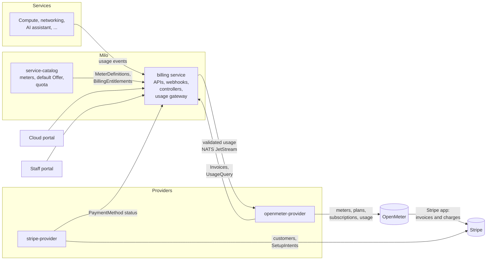

# Milo's Billing Platform for Service Providers

- [Overview](#overview)
- [How it fits together](#how-it-fits-together)
- [Capabilities](#capabilities)
  - [Billing accounts and project bindings](#billing-accounts-and-project-bindings)
  - [Payment methods](#payment-methods)
  - [Payment terms (pay by invoice)](#payment-terms-pay-by-invoice)
  - [Usage metering](#usage-metering)
  - [Pricing, Offers and entitlements](#pricing-offers-and-entitlements)
  - [Discounts](#discounts)
  - [Contracts](#contracts)
  - [Invoices and invoice previews](#invoices-and-invoice-previews)
  - [Usage and spend reporting](#usage-and-spend-reporting)
  - [Credits](#credits)
  - [Activity and notifications](#activity-and-notifications)
- [Billing providers](#billing-providers)
  - [OpenMeter provider](#openmeter-provider)
  - [Stripe provider](#stripe-provider)
  - [Amberflo provider (retired)](#amberflo-provider-retired)
- [Portals](#portals)
  - [Cloud portal (customers)](#cloud-portal-customers)
  - [Staff portal](#staff-portal)
- [Resource reference](#resource-reference)
- [Access control](#access-control)
- [Not built yet](#not-built-yet)
- [Enhancement proposals](#enhancement-proposals)
- [Implementation history](#implementation-history)

## Overview

Milo's billing platform lets a service provider charge its customers for what
they use. Customers get billing accounts, link projects to them, and pay by card
or by invoice. Services report usage as events. The platform prices that usage
against Offers, invoices each account monthly, and collects payment.

Billing is declarative. Every concept is a Kubernetes resource in the
`billing.miloapis.com` API group, served by Milo. The
[billing service](https://github.com/milo-os/billing) owns the APIs, validation
and business rules. **Providers** connect those resources to external systems
that rate usage, issue invoices and take payments. Billing doesn't know which
provider is behind it, so a provider can be replaced without changing the API
or the portals.

> [!NOTE]
>
> **Status (4 November 2026)**: Datum Cloud bills customers through this
> platform in production. Billing accounts, card payments, payment terms,
> metering, pricing, discounts, contracts and invoicing are built. Credits are
> built but switched off. Budgets, suspension for non-payment, hierarchical
> billing and multi-currency are not built yet. See
> [Not built yet](#not-built-yet).
>
> The detailed designs live next to the code in
> [milo-os/billing `docs/enhancements`](https://github.com/milo-os/billing/tree/main/docs/enhancements).
> This page summarises them and links to each one.

## How it fits together

- **Services** declare their meters in the service catalog and emit usage events
  through the billing emission SDK.
- **The billing service** validates usage, attributes it to the billing account
  the project is bound to, and publishes it to NATS JetStream. It also serves
  the billing API, enforces its rules with admission webhooks, and keeps account
  status (payment readiness, invoicing health, discounts) up to date.
- **openmeter-provider** turns meters, Offers and entitlements into OpenMeter
  meters, plans and subscriptions. It submits usage to OpenMeter, mirrors
  OpenMeter's invoices back as `Invoice` resources, and serves usage and spend
  queries. OpenMeter's own Stripe app issues the invoices in Stripe and charges
  the card.
- **stripe-provider** keeps a Stripe customer for each billing account and runs
  card collection with Stripe SetupIntents.
- **The cloud portal** is where customers manage billing. **The staff portal**
  is where Datum staff run it.

## Capabilities

| Capability | Status | Design |
|---|---|---|
| Billing accounts and project bindings | Built | [Billing Accounts](./accounts/), [design.md][design] |
| Payment methods (cards) | Built | [payment-methods.md][payment-methods] |
| Payment terms (pay by invoice) | Built: staff grants, customer applications | [billing-arrangements.md][arrangements] |
| Usage metering pipeline | Built | [usage-pipeline.md][usage-pipeline], [emitting-usage.md][emitting-usage] |
| Pricing, Offers and entitlements | Built | [Pricing and Offers](./pricing-and-offers/) |
| Offer discounts | Built | [offer-discounts.md][offer-discounts] |
| Contracts (start date, fixed fees, amendments) | Built; end of term not yet | [contract-billing.md][contract-billing] |
| Invoices and invoice previews | Built | [invoicing.md][invoicing], [contract-billing.md][contract-billing] |
| Usage and spend reporting | Built | [usage-query.md][usage-query] |
| Credits and signup credit | Built, switched off | [credits][credits] |
| Billing activity timeline | Built | [billing-activity.md][billing-activity] |
| Suspension for non-payment | Proposed | [milo-os/billing#208][pr-208] |
| Budgets and alerts | Not started | |
| Hierarchical billing (sub-accounts) | Not started | [Billing Accounts](./accounts/#future-enhancement-hierarchical-billing) |
| Multi-currency | Not started (USD only) | |

### Billing accounts and project bindings

A `BillingAccount` is the party that pays. It lives in an organization's
namespace and holds the currency, contact details, invoice email, billing
address, tax IDs and the default payment method. An organization gets one
account by default. The `multi-billing-accounts` feature raises the limit.

A `BillingAccountBinding` links a project to the account that pays for it. A
binding can't be edited. To move a project to another account, create a new
binding; billing marks the old one `Superseded`, so the history of who paid for
what stays intact. A binding is deleted when its project is deleted. Usage from
a project with no binding is dropped at the gateway.

Every account has standard terms: net 30, invoiced monthly on the 1st. They
can't be edited on the account; custom terms come from a payment terms
arrangement (below).

Billing keeps four conditions on each account:

- `Ready`
- `DefaultPaymentMethodReady`
- `PaymentReady`: the account can pay, by card or by invoice terms.
- `InvoicingReady`: no invoice is past due.

Milo's organization onboarding waits for `PaymentReady`.

### Payment methods

A `PaymentMethod` is a card on a billing account. Its `PaymentMethodClass`
names the provider that collects it, in the same way a Gateway API
`GatewayClass` names a controller. Datum's default class points to
stripe-provider. The provider writes the card details (brand, last four,
expiry, country, AVS and CVC checks) and the phase to the payment method's
status. Billing makes the first active card the account's default and records
an event when a card is about to expire.

Only cards are supported today. Bank accounts exist in the API but no provider
implements them.

### Payment terms (pay by invoice)

Staff grant payment terms with a `BillingArrangement` of type `Invoice`. It
carries:

- the payment due period (`netDays`, 1-90 days)
- a credit limit
- the accounts payable email
- an optional purchase order number and agreement reference
- start and end dates

Arrangements for one account can't overlap. While an arrangement is active,
billing copies its terms onto `BillingAccount.status.paymentArrangement` and
the account counts as payment-ready without a card.

Customers apply for terms from the cloud portal with a
`BillingArrangementApplication`. Staff review the application in the staff
portal. Approving it creates an arrangement that references it. Declining it
creates a `BillingArrangementDecline`, which holds a message for the customer
and internal notes. Billing emails the support mailbox when an application
arrives, and emails the applicant when it's received and when it's decided.

Providers act on the arrangement:

- **openmeter-provider** gives the account its own OpenMeter billing profile
  with `send_invoice` collection and the arrangement's due days. Invoices are
  emailed and not charged to a card.
- **stripe-provider** creates a Stripe customer even when the account has no
  card. It also prints the PO number and agreement reference on every invoice.

Customers can apply for terms in staging but not yet in production. The
`PAYMENT_TERMS_ENABLED` setting in the cloud portal controls this. Staff can
grant terms in both environments.

### Usage metering

Services declare what they meter in their `ServiceConfiguration`. The service
catalog publishes these as cluster-wide `MeterDefinition` and
`MonitoredResourceType` resources. Each meter moves through the phases Draft,
Published, Deprecated and Retired.

Services emit CloudEvents through the billing emission SDK. Each event has an
idempotency key.

1. **Gateway.** Billing's gateway writes events to NATS JetStream with
   deduplication.
2. **Consumer.** A consumer checks each event against its meter definition. It
   attributes the event to the billing account the project is bound to and adds
   the `project_name` dimension. Invalid events go to quarantine.
3. **Submission.** openmeter-provider's submission consumer reads the validated
   stream. It sends the events to OpenMeter keyed by billing account.

OpenMeter deduplicates over a window longer than billing's 30-day replay.

### Pricing, Offers and entitlements

- **`ServicePricing`** is one price for one thing. It has one of three charge
  types:
  - `Usage` pricings select a meter and set flat or tiered rates. A rate can
    match a single dimension, such as region. A pricing can also convert meter
    units to pricing units, for example bytes to GB.
  - `OneTime` pricings charge a fixed amount when billing starts.
  - `Recurring` pricings charge a fixed amount every month.

  A pricing's spec can't change once created. A new price is a new pricing.
  Service pricings live in Git next to each service's meters, with separate
  manifests for staging and production.
- **`Offer`** bundles pricings into a named package, such as pay-as-you-go or a
  customer's own contract. When an Offer is published (`GA`), billing writes a
  snapshot of every pricing into it and freezes it. Providers bill from that
  snapshot, so a later price change never reprices existing customers.
  Billing refuses to publish an Offer that prices the same meter twice.
- **`BillingEntitlement`** puts a billing account on exactly one published
  Offer. The service catalog gives every new account an entitlement to the
  platform's default Offer. Staff can switch an account to another Offer.

See [Pricing, Offers, and Billing Entitlements](./pricing-and-offers/).

### Discounts

An Offer can carry a percentage discount for the whole Offer, and a separate
discount for each pricing in it. A customer's negotiated discount is their own
Offer. Changing or ending a discount means moving the account to a different
Offer. Billing copies the discounts in effect onto
`BillingAccount.status.discounts` so customers can see them, since customers
can't read Offers. The provider shows the list price, the discount and the net
amount on the invoice. See [offer-discounts.md][offer-discounts].

### Contracts

Bare metal and other contract customers pay a one-time setup fee and then a
fixed monthly fee for a term. They often also pay for usage, and usually pay
by invoice. Staff build a contract from existing pieces:

1. A `BillingArrangement` for invoice terms, with the contract's PO number and
   agreement reference.
2. `OneTime` and `Recurring` pricings for the fees, in an Offer for this
   customer. The Offer can also include the platform's usage pricings, so
   usage is billed alongside the fixed fees.
3. The account's `BillingEntitlement` pointed at that Offer, with
   `contract.startsAt` set.

`contract.startsAt` is the day the contract's charges start. The account is
billed on that day of every month; a contract starting on the 29th to 31st
bills on the last day of shorter months.

- **Start date.** It can be today or up to a year ahead, not in the past,
  because OpenMeter can't start a subscription retroactively. Once set, the
  contract can't be moved or removed.
- **Existing customers.** An account can move onto a contract. Until the start
  date it's billed as before, then it moves to the contract's Offer and billing
  day.
- **Amendments.** To change the fees after the contract starts, point the
  entitlement at a new Offer. The change applies from the next billing date, so
  each invoice carries one price. An amended Offer leaves out the setup fee,
  which has already been charged.
- **First invoice.** The setup fee and first month are invoiced automatically
  on the start date.

The staff portal has a guided "Set up contract" flow and a preview of the first
invoice. Ending or renewing a contract at the end of its term is designed but
not built. The plan is to continue month-to-month by default, with the account
flagged for renewal 90 days before the end. See
[contract-billing.md][contract-billing], and
[User Stories](../README.md#user-stories) in the platform enhancement for
worked examples.

### Invoices and invoice previews

`Invoice` resources are written only by the invoicing provider. Each invoice
has:

- a billing period and currency
- the total, amount paid and amount due
- credits applied
- a due date
- a link to the hosted invoice page

Its phase is `Open`, `Paid`, `PastDue` or `Void`. openmeter-provider creates
one for every invoice OpenMeter issues. It also creates one for invoices that
staff create by hand in Stripe, and it reflects credit notes and partial
payments. Billing sets the account's `InvoicingReady` condition from the
account's invoices and records the latest one.

An `InvoiceRequest` with mode `Preview` asks the provider what the account
will be invoiced next for its fixed charges, without creating anything. Before
a contract starts, that is the contract's first invoice. Requests are staff
only. The API also has an `Issue` mode, but openmeter-provider rejects it as
`Unsupported`, because OpenMeter invoices in-advance fees as soon as they're
due.

Non-contract accounts are invoiced monthly on the 1st. Contract accounts are
invoiced on their start day. Stripe emails each invoice to the account's
invoice email.

### Usage and spend reporting

`UsageQuery` (`usage.billing.miloapis.com/v1alpha1`) is a create-only,
never-stored query for usage and spend. openmeter-provider serves it from an
aggregated API server.

- **Scope.** The scope comes from where the query is made: a project, an
  organization, or platform-wide for staff. The query can narrow that scope but
  never widen it.
- **What it returns.** Usage over time per meter, grouped by up to three
  dimensions. With `includeSpend`, it prices the usage against the account's
  Offer, discounts included.

The same data feeds:

- the cloud portal's usage dashboards
- the staff portal's account and organization usage views
- the `datumctl billing usage` and `datumctl billing meters` commands
- `billing mcp`, a read-only MCP server that gives the Datum AI assistant
  project-scoped usage, invoice and payment method tools

### Credits

A `CreditGrant` gives a billing account a dollar balance that usage draws down
before anything is charged. Each grant records the amount, the reason
(promotional, sponsorship or goodwill), a description and an expiry. Staff can
void a grant.

An Offer can carry a signup credit. Billing grants it once per organization,
when the account's first card becomes active.

`BillingAccountBalance` reports the remaining credit and a forecast for the
current period, live from the provider. Billing's side is built but sits behind
the `CreditGrants` feature gate, which is off.

openmeter-provider support is in progress
([openmeter-provider#67](https://github.com/milo-os/openmeter-provider/pull/67)).
It is waiting on an upstream OpenMeter fix: credits skip lines that have a
percentage discount. Neither portal has a credits screen yet. See
[credits][credits].

### Activity and notifications

Billing changes appear on the organization's activity timeline. Billing and
the providers record Kubernetes Events with structured annotations:

- **Billing:** payment method changes and expiry, a past-due account and its
  recovery, and payment terms ending.
- **openmeter-provider:** invoice events (issued, paid, partly paid, past due,
  voided, payment failed with a normalised decline reason). These are merged
  but not released, so only staging has them.

Activity policies cover accounts, bindings, arrangements, applications,
declines, invoices, invoice requests and payment methods, so people's changes
are shown in readable sentences. See [billing-activity.md][billing-activity].

## Billing providers

### OpenMeter provider

[milo-os/openmeter-provider](https://github.com/milo-os/openmeter-provider) is
the invoicing and rating provider. It went live in production on
24 October 2026, replacing Amberflo.

It runs three workloads:

- a **controller manager** that syncs Milo resources into OpenMeter
- a **submission consumer** that forwards validated usage from NATS JetStream
  to OpenMeter's ingest API
- an **aggregated API server** that serves `UsageQuery`

It ships and runs OpenMeter itself, which uses Postgres, Kafka and Redis and
stores usage in ClickHouse. Svix handles OpenMeter's webhook delivery.

| Milo resource | What it becomes in OpenMeter |
|---|---|
| `MeterDefinition` | A meter. Kept after the meter retires, so late usage still bills. |
| `BillingAccount` | A customer, keyed by account UID. Also a private billing profile when the account has invoice terms, and the Stripe customer and card details OpenMeter's Stripe app charges. |
| `Offer` (published) | A plan with features and rate cards. Usage rates become features, `Recurring` fees become monthly in-advance flat fees, `OneTime` fees become one-off flat fees. Unit conversions and discounts carry over. A changed Offer publishes a new plan version. |
| `BillingEntitlement` | A subscription to the Offer's plan, anchored on the 1st, or on `contract.startsAt` for contracts. Contract moves and amendments wait for the right date. |
| `InvoiceRequest` | `Preview` is answered from the Offer before a contract starts, and from OpenMeter's draft or upcoming lines after. `Issue` fails as `Unsupported`. |
| OpenMeter and Stripe invoices | Milo `Invoice` resources with a link to Stripe's hosted invoice page and the Stripe invoice number. |

The provider reports progress on each resource through conditions and Events,
such as `OpenMeterPlanSynced`, `OpenMeterSubscriptionSynced`,
`ContractNotStarted` and `OfferChangeScheduled`. It also sets annotations under
`openmeter.miloapis.com/`.

When an account is deleted, the provider invoices anything pending. It then
waits for unpaid invoices to be paid, voided or written off before it removes
the customer.

### Stripe provider

[milo-os/stripe-provider](https://github.com/milo-os/stripe-provider) owns the
Stripe customer and card collection. It adds its own resources in
`stripe.billing.miloapis.com`:

- `StripeProviderConfig`: the publishable key and the tax ID types Stripe
  accepts.
- `StripePaymentMethod`: the SetupIntent behind a `PaymentMethod`.
- `StripeCustomer`: the Stripe customer for accounts on invoice terms that have
  no card.

Card collection works like this:

1. The cloud portal creates a `PaymentMethod`.
2. stripe-provider creates a SetupIntent and publishes its client secret on the
   `StripePaymentMethod`.
3. The portal confirms the card with Stripe Elements.
4. Stripe's `setup_intent.succeeded` webhook tells stripe-provider the card is
   ready, and stripe-provider marks the `PaymentMethod` `Active` with the card
   details. A declined card marks it `Failed`, with the reason.

stripe-provider keeps the Stripe customer in step with the billing account:

- name, invoice email and address
- tax IDs
- the default card
- the PO number and agreement reference from payment terms

It never deletes a Stripe customer, so invoice history is kept. It doesn't
create invoices or charges; OpenMeter's Stripe app does.

### Amberflo provider (retired)

[milo-os/amberflo-provider](https://github.com/milo-os/amberflo-provider) was
the first provider. It synced meters, Offers and entitlements into Amberflo and
projected Amberflo invoices into Milo. It was removed from every cluster on
23 October 2026, after OpenMeter took over. Production never had Offers on it,
and staging was being invoiced twice. The cloud portal and staff portal hide
the invoices it left behind.

## Portals

### Cloud portal (customers)

[datum-cloud/cloud-portal](https://github.com/datum-cloud/cloud-portal) shows
billing to an organization's owners. Billing has been generally available since
2 November 2026, when the `cloud-portal-billing` feature flag was removed.

- **Onboarding.** A new organization adds its contact details and a card. The
  portal creates its billing account and payment method before the first
  project is created. Organizations on payment terms pass this step without a
  card.
- **Billing accounts.** Owners can do the following:
  - list and create accounts (more than one with `multi-billing-accounts`)
  - rename and delete accounts
  - add, remove and choose the default card (Stripe Elements)
  - edit the invoice email, billing address and tax IDs, next to a mock-up of
    how they print on an invoice
- **Payment terms.** Owners can see the terms in effect, or apply for terms and
  follow the application through review, approval or decline.
- **Discounts** in effect on the account.
- **Invoices.** A list of invoices, each linked to Stripe's hosted page.
- **Projects.** Owners choose which account pays for each project, from the
  organization's billing page or the project's settings. New projects are bound
  to the organization's default account automatically.
- **Usage dashboards** for organizations and projects. They show usage and spend
  for the current or previous billing cycle per meter and service, from
  `UsageQuery`, and hide services the project isn't entitled to.

### Staff portal

[datum-cloud/staff-portal](https://github.com/datum-cloud/staff-portal) is where
Datum staff run billing:

- **Billing accounts.** A fleet-wide list. Each account has a dashboard with:
  - an attention banner (past-due invoices, an unusual invoice amount, a card
    expiring, a missing tax ID, a usage spike and similar)
  - health tiles for outstanding balance, past due, lifetime paid and this
    cycle's usage
  - usage and spend by meter and service
  - invoices with their Stripe numbers
  - bound projects with their spend
  - payment methods and terms
  - the contract and the active Offer
  - an activity feed
- **Payment terms.** Grant, change and end terms. There's also a queue of
  customer applications to approve or decline.
- **Offers.** Draft, discount, publish and set the default Offer. A
  published Offer can't change, so a price change is a new Offer.
- **Switch Offer.** Move an account onto another published Offer.
- **Contracts.** A "Set up contract" flow that creates the fee pricings and the
  customer's Offer and sets the start date. A "Change contract fees" flow for
  amendments. A preview of the first or next invoice.
- **Service catalog pricing.** Every service's pricings, with their rates and
  tiers.
- **Organization and project views** with billing bindings and usage.
- **Assistant tools.** The staff assistant can look up accounts, invoices,
  payment terms, applications, usage and Offers.

## Resource reference

| Kind | Scope | Written by |
|---|---|---|
| `BillingAccount` | Organization | Customer; status by billing |
| `BillingAccountBinding` | Organization | Customer |
| `PaymentMethod` | Organization | Customer; status by the payment provider |
| `PaymentMethodClass` | Cluster | Operators |
| `BillingArrangement` | Organization | Staff |
| `BillingArrangementApplication` | Organization | Customer |
| `BillingArrangementDecline` | Organization | Staff |
| `MeterDefinition`, `MonitoredResourceType` | Cluster | Service catalog |
| `ServicePricing` | `milo-system` | Services (GitOps); staff for contract fees |
| `Offer` | Cluster | Staff; snapshot by billing |
| `BillingEntitlement` | Organization | Service catalog (default Offer); staff |
| `Invoice` | Organization | Invoicing provider only |
| `InvoiceRequest` | Organization | Staff; status by the invoicing provider |
| `CreditGrant` | Organization | Staff, or billing for signup credit; status by the provider |
| `UsageQuery` | Project, organization or platform (not stored) | Anyone with usage access |
| `BillingAccountBalance` | Organization (not stored) | Read-only, served by the provider |

## Access control

Billing ships Milo IAM roles:

- **For customers:**
  - `billing.miloapis.com-admin`: accounts, bindings, payment methods, payment
    terms applications.
  - `billing.miloapis.com-viewer`.
  - `billing.miloapis.com-usage-viewer`.
- **For staff and operators:** admin and viewer roles for:
  - billing arrangements
  - billing entitlements, which include invoice requests
  - credits
  - meter definitions
  - monitored resource types
  - Offers
  - payment method classes
  - service pricings

  There is also a `service-pricing-creator` role, so staff can add contract fees
  without being able to change the platform's prices.

Staff role bindings are kept in Datum's infrastructure repository. The cloud
portal shows billing only to organization owners.

## Not built yet

- **Suspension and closure.** No billing code moves an account to `Suspended` or
  `Archived` yet. Restricting and suspending accounts for non-payment is
  proposed in [milo-os/billing#208][pr-208].
- **Credit limits.** A payment terms arrangement records a credit limit, but
  nothing alerts on it or enforces it.
- **End of a contract's term.** Renewing, continuing month-to-month or stopping
  a contract when its term ends is designed in
  [contract-billing.md][contract-billing] but not built.
- **Credits** are off until openmeter-provider supports them.
- **Minimum spend commitments, liens and reserved capacity.** These are
  described in the [platform enhancement](../README.md#commitments) but not
  built.
- **Budgets, alerts and forecasting.** Spending limits at account and project
  level, threshold alerts, projected spend and anomaly detection.
- **Hierarchical billing.** Sub-accounts for resellers and channel partners.
- **Multi-currency.** Everything is USD.
- **Bank transfers and other payment methods.** Only cards can be collected
  online. Reconciling bank transfers from invoice customers is still open.
- **In progress:**
  - customers seeing their contract in the cloud portal
    ([milo-os/billing#211](https://github.com/milo-os/billing/pull/211))
  - a fleet-wide billing overview for staff
    ([milo-os/billing#213](https://github.com/milo-os/billing/pull/213))
  - binding every project to its organization's account
    ([milo-os/billing#209](https://github.com/milo-os/billing/pull/209))

## Enhancement proposals

In this repository:

- [Initial Scope for Billing Datum Cloud Consumers](./initial-scope.md)
- [Billing Accounts](./accounts/)
- [Service Pricing, Offers, and Billing Entitlements](./pricing-and-offers/)

In [milo-os/billing](https://github.com/milo-os/billing/tree/main/docs/enhancements):

- [Billing service design][design]
- [Usage pipeline][usage-pipeline] and [emitting usage][emitting-usage]
- [Payment methods][payment-methods]
- [Invoicing][invoicing]
- [Billing arrangements][arrangements]
- [Usage query][usage-query]
- [Offer discounts][offer-discounts]
- [Credits][credits]
- [Contract billing][contract-billing]
- [Billing activity][billing-activity]

## Implementation history

- **2025-08-21:** Billing accounts enhancement.
- **2026-04-28:** Billing service started: `BillingAccount` and
  `BillingAccountBinding`, the meter catalog and the usage pipeline design.
- **2026-05-08:** Durable usage pipeline: JetStream gateway and attribution.
- **2026-05-22:** `PaymentMethod` and `PaymentMethodClass`. stripe-provider's
  first release followed on 27 May.
- **2026-06-05:** First billing screens in the cloud portal, behind a feature
  flag. The staff portal followed on 9 June.
- **2026-07-28:** `Invoice` and `InvoicingReady`. Invoices appear in both
  portals.
- **2026-07-31:** `ServicePricing`, `Offer` and `BillingEntitlement`.
- **2026-08-25:** Offer authoring in the staff portal.
- **2026-10-05:** openmeter-provider started. Plans and subscriptions followed
  on 10 October, `UsageQuery` on 14 October.
- **2026-10-07:** Payment terms granted by staff (`BillingArrangement`,
  `PaymentReady`).
- **2026-10-14:** `UsageQuery` API. Both portals moved their usage views to it
  on 21 October.
- **2026-10-21:** `datumctl billing` plugin.
- **2026-10-23:**
  - Billing MCP server.
  - Payment terms applications and declines.
  - Amberflo removed from every cluster.
- **2026-10-24:** openmeter-provider live in production.
- **2026-10-26:**
  - Pricing selects meters: standalone `ServicePricing` replaces
    `ServiceConfiguration.spec.charges`.
  - Offer discounts.
- **2026-10-27:** Customers apply for payment terms in the cloud portal.
- **2026-10-28:**
  - `CreditGrant` and `BillingAccountBalance`.
  - Invoice-only accounts get a Stripe customer.
  - PO number and agreement reference print on invoices.
- **2026-10-29:** New subscriptions bill on the 1st.
- **2026-11-02:**
  - Contract start date and `InvoiceRequest` previews.
  - Billing generally available to organization owners in the cloud portal.
- **2026-11-03:**
  - Moving accounts onto contracts, and amending contracts.
  - Staff billing account dashboard.
  - Stripe invoices synced into Milo.
- **2026-11-04:**
  - Contract set-up and invoice preview in the staff portal.
  - Billing activity events.

[design]: https://github.com/milo-os/billing/blob/main/docs/design.md
[emitting-usage]: https://github.com/milo-os/billing/blob/main/docs/emitting-usage.md
[usage-pipeline]: https://github.com/milo-os/billing/blob/main/docs/enhancements/usage-pipeline.md
[payment-methods]: https://github.com/milo-os/billing/blob/main/docs/enhancements/payment-methods.md
[invoicing]: https://github.com/milo-os/billing/blob/main/docs/enhancements/invoicing.md
[arrangements]: https://github.com/milo-os/billing/blob/main/docs/enhancements/billing-arrangements.md
[usage-query]: https://github.com/milo-os/billing/blob/main/docs/enhancements/usage-query.md
[offer-discounts]: https://github.com/milo-os/billing/blob/main/docs/enhancements/offer-discounts.md
[credits]: https://github.com/milo-os/billing/blob/main/docs/enhancements/credits/README.md
[contract-billing]: https://github.com/milo-os/billing/blob/main/docs/enhancements/contract-billing.md
[billing-activity]: https://github.com/milo-os/billing/blob/main/docs/enhancements/billing-activity.md
[pr-208]: https://github.com/milo-os/billing/pull/208
